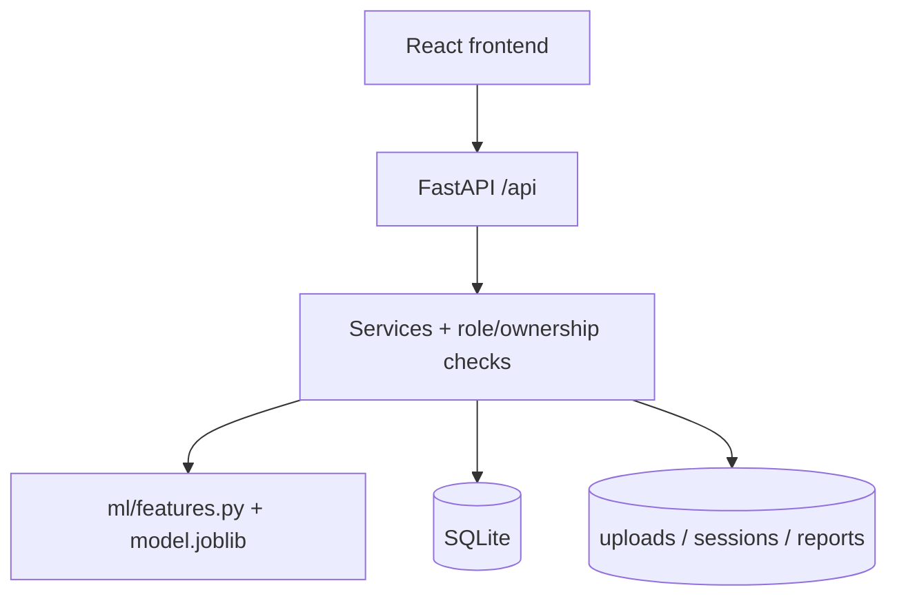

# AURASENSE — COMPLETE PROJECT EXPLANATION, TECHNICAL ARCHITECTURE AND FUNCTIONALITY AUDIT

_Audit date: 08 November 2026 · Model version aura-wesad-20261107-444b41_

> This report inspects the existing AuraSense build. No application source file, database record or trained artifact was modified.

## Table of contents

- **0** [Executive summary and how this audit was performed](#executive-summary-and-how-this-audit-was-performed)
- **1** [Understanding AuraSense in plain English](#understanding-aurasense-in-plain-english)
- **2** [The complete technology stack](#the-complete-technology-stack)
- **3** [How the whole system works together](#how-the-whole-system-works-together)
- **4** [The AI and machine-learning engine](#the-ai-and-machine-learning-engine)
- **5** [WESAD and the biological signals](#wesad-and-the-biological-signals)
- **6** [Every module, examined one by one](#every-module-examined-one-by-one)
- **7** [BioSignal Lab: the complete CSV upload audit](#biosignal-lab-the-complete-csv-upload-audit)
- **8** [Live Monitor: what is really happening](#live-monitor-what-is-really-happening)
- **9** [My Baseline and personalisation](#my-baseline-and-personalisation)
- **10** [Research Centre and scientific evaluation](#research-centre-and-scientific-evaluation)
- **11** [Institution Insights, consent and data privacy](#institution-insights-consent-and-data-privacy)
- **12** [Reports, history and PDF generation](#reports-history-and-pdf-generation)
- **13** [Scientific authenticity and reliability](#scientific-authenticity-and-reliability)
- **14** [Authentication, users and public access](#authentication-users-and-public-access)
- **15** [Functionality testing and evidence](#functionality-testing-and-evidence)
- **16** [Project file structure and responsibilities](#project-file-structure-and-responsibilities)
- **17** [Three complete end-to-end examples](#three-complete-end-to-end-examples)
- **18** [Final audit and honest verdict](#final-audit-and-honest-verdict)
- **19** [The student-friendly guide, viva preparation and glossary](#the-student-friendly-guide-viva-preparation-and-glossary)
- **A** [Appendix A — Complete API surface](#appendix-a-complete-api-surface)
- **B** [Appendix B — Database tables](#appendix-b-database-tables)
- **C** [Appendix C — CSV quick reference](#appendix-c-csv-quick-reference)
- **D** [Appendix D — Reproducing this audit](#appendix-d-reproducing-this-audit)

## 0. Executive summary and how this audit was performed

_The short answer first: what exists, what is real, what is only demonstrated, and what is still missing._

AuraSense is a working research prototype that turns physiological time-series signals into a three-class pattern estimate: neutral-associated, stress-associated or amusement-associated. It is not a mock-up. A model was genuinely trained on the public WESAD dataset, the trained artifact is loaded by the backend, and predictions are produced from 20 extracted signal features. Around that model sits a complete web application with accounts, a live simulation, CSV upload, personal baselines, a research console, privacy-limited cohort aggregates and generated PDF reports.

This report was produced by reading the actual source, inspecting the saved artifacts and database, calling the running API, and running the existing test suite. Every number quoted below is taken from this installation, not from the design brief.

| Field | Value |
| --- | --- |
| Product | AuraSense — “Beyond the pulse. Understand the pattern.” |
| What it is | AI-assisted physiological stress-pattern research platform |
| Frontend | React 19.3.1 + TypeScript 7.0.2 + Vite 8.3.6 + Tailwind CSS 4.3.5 + Recharts 3.10.1 |
| Backend | FastAPI 0.162.0 on Python 3.14.4, SQLAlchemy 2.1.8, SQLite |
| Model | Gradient Boosting (scikit-learn HistGradientBoostingClassifier) |
| Model version | aura-wesad-20261107-444b41 |
| Training data | WESAD local installation: 15 participants, 1,032 windows |
| Evaluation | 5-fold GroupKFold by participant (no participant leakage) |
| Balanced accuracy | 76.9% for the selected model; 82.8% raw accuracy, 76.7% macro F1 |
| Database snapshot | 16 users, 41 analyses, 9 monitoring sessions, 5 datasets, 3 experiments, 5 report records |
| Audit date | 8 November 2026 |

### The ten findings that matter most

- The machine learning is genuine. WESAD participant pickles were processed, 1,032 windows were extracted, three algorithms were compared with participant-independent folds, and a model artifact of 1.77 MB is used at request time.
- WESAD is genuinely integrated, but only the chest channels are used for the 20 training features: ECG, EDA, respiration, temperature, EMG and chest accelerometer. Wrist BVP/EDA/temperature slices are loaded during extraction but are not passed into feature extraction. This is a real design limitation, not a claim that wrist data was used.
- The application does not call OpenAI, Gemini or any external AI service. There is no large language model and no cloud inference. All predictions come from the locally stored scikit-learn model.
- Live Monitor is entirely simulated. Signals are synthesised on the server at 250 Hz (ECG) and 4 Hz (EDA, respiration, temperature, accelerometer), then pushed through the same preprocessing and model as uploaded data. No wearable, Bluetooth device, camera or phone sensor is accessed.
- BioSignal Lab genuinely accepts and processes real CSV files. It detects channels and sampling rate, extracts features, runs the model, saves the analysis and keeps the uploaded file. It does not convert units and does not guarantee that a consumer wearable's channels are comparable to WESAD chest sensors.
- AI Analysis runs the real model on cached WESAD feature rows, not on freshly re-read raw WESAD signals. The features were extracted offline; the prediction itself is genuine inference on those rows.
- Research Centre metrics are the saved output of a real grouped evaluation. Accuracy, balanced accuracy, macro F1, confusion matrices, per-participant scores and permutation importance all come from ml/artifacts/metrics.json. They are not typed into the interface.
- PDF reports are genuinely generated with fpdf2 from stored analysis, research and aggregate records. Report records point to real files, downloads are ownership-checked, and the research PDF embeds the real confusion matrix and per-participant results.
- Security is appropriate for a local demonstration but not for public use yet: a development secret key is the default, JWT is stored in localStorage, there is no rate limiting, no email verification, no password reset, no HTTPS, SQLite is the default and uploaded/raw files are not encrypted at rest.
- Data deletion is incomplete. Account deletion removes database rows but does not delete uploaded CSVs, retained session CSVs or orphaned report PDFs from disk. Aggregate summaries can also include records from weeks whose group was suppressed in the weekly table.

### What is real, simulated, hardcoded or absent

| Capability | Verdict | Evidence in the build |
| --- | --- | --- |
| WESAD feature extraction | REAL | ml/wesad_extract.py reads S2–S11, S13–S17; artifacts/wesad_features.csv has 1,032 rows |
| Model training + validation | REAL | ml/train.py, GroupKFold, metrics.json, model.joblib |
| Prediction on upload / reference | REAL | inference.predict_windows loads joblib artifact and calls predict_proba |
| Local explanations | REAL ALTERNATIVE | Occlusion contribution analysis; SHAP is not installed |
| Global feature importance | REAL ALTERNATIVE | Permutation importance on held-out folds |
| Live Monitor signals | SIMULATED | services/simulation.py; every response sets is_simulation=true |
| Demo users / cohort / sessions | SEEDED DEMO | seed.py marks is_demo=true; UI labels these records |
| Institution cohort data | SEEDED + OPT-IN DEMO | 12 synthetic participants with share_aggregate=true |
| AI chatbot / external AI API | ABSENT | No API key, SDK or network call to any model provider |
| Wearable / phone sensor access | ABSENT | No Bluetooth, Web Serial, camera or device integration |
| Probability calibration | ABSENT | Raw predict_proba is displayed; one WESAD neutral window scored 1.000 |
| Email verification / reset | ABSENT | No mail service or token flow |
| Production deployment | ABSENT | Runs on 127.0.0.1 only; no Docker, TLS or hosted configuration |

> **Bottom line** — For a faculty demonstration, AuraSense is credible: it has a real dataset, a real trained model, real evaluation, a working API and a polished interface. For public or clinical use it is not ready: the dataset is small and laboratory-based, probabilities are uncalibrated, sensor/unit assumptions are not validated, and deployment, privacy cleanup and security hardening are incomplete. The right description is “a working research prototype with genuine ML”, not “a medical or commercial product”.

### How the audit was performed

- Read the frontend routes and pages, all nine FastAPI routers, the service layer, database models, security helpers, seed logic, report generator and ML pipeline.
- Inspected model artifacts: model.joblib, metrics.json, dataset_summary.json, the 1,032-row feature table and 15 per-participant feature caches.
- Queried the SQLite database read-only to count users, sessions, analyses, datasets, experiments and reports, and checked role/consent flags.
- Started the API and frontend, signed in with all three demonstration accounts, called read-only endpoints, confirmed a 403 for an individual on institution data, and loaded live model information.
- Ran the existing test suite: 5 passed. Inspected the seven stored PDF files (2–3 pages, 1.9–6.0 KB) and the uploaded/session signal files.
- Did not create, delete or alter application records, source files, seed data or trained artifacts. The only new files are this report and its build script under app/audit/.

## 1. Understanding AuraSense in plain English

_What problem it addresses, who it is for, what a first-time user sees, and what it honestly cannot do._

### 1. What exactly is AuraSense?

AuraSense is a web application that studies the body's signals and estimates which of three laboratory conditions a recording most resembles. Those conditions are neutral (calm baseline), stress (a laboratory stress task) and amusement (a positive-affect film clip). It shows the estimate with a confidence-like score, an uncertainty value, a signal-quality score and an explanation of which measured features influenced the result.

It is a pattern-similarity tool, not a stress meter. If a recording looks like the stress examples the model learned, AuraSense calls it a “stress-associated pattern”. It never says “you are stressed”, because physiology alone cannot establish that.

### 2–3. What real-world problem does it address, and why is it useful?

Wearables produce large amounts of ECG, skin-conductance and movement data, but raw numbers are hard to interpret. AuraSense demonstrates an end-to-end research workflow: collect or upload signals, check whether they are usable, extract interpretable features, compare them with a published research dataset, show the result honestly, and let a researcher inspect the evidence behind the model. It is useful as a teaching and research prototype because it makes the whole pipeline visible instead of hiding it behind a single percentage.

### 4–6. Intended users, main objective and major capabilities

The application has three roles. An individual user explores their own readings, uploads files, builds a personal baseline and downloads reports. A researcher can additionally run model experiments, see the Research Centre and generate research reports. An institution/admin account can see consent-based cohort aggregates. The main objective is to demonstrate a scientifically cautious, explainable stress-pattern pipeline, not to diagnose anyone.

- A public landing page that reports the real measured balanced accuracy from the model artifact.
- A personal workspace with an overview, latest estimate, quality state, trends and analysis history.
- A simulated live monitor with five scenarios, waveform views, heart-rate estimation and prediction history.
- AI Analysis on cached WESAD reference windows and on demonstration datasets.
- BioSignal Lab for real CSV/TSV uploads with automatic channel and sampling-rate detection.
- A personal baseline built from the user's own completed analyses, with z-score comparison and reliability tiers.
- A Research Centre with model comparison, confusion matrices, per-class and per-participant results, importance and rerunnable experiments.
- Privacy-limited Institution Insights with weekly aggregates, minimum-cohort suppression, CSV export and a PDF.
- Reports & History with PDF generation, download and deletion, plus account settings, JSON export and account deletion.

### 7. What happens when a new user opens the application?

They land on a public page that explains the product and shows the real model metric. They can create an individual account, or a researcher account with the invitation code AURA-RESEARCH. After signing in they reach /app, which loads their analyses, baseline, sessions and model information from the API. With a fresh account all lists are empty: the interface explains how to start with a simulated session or a CSV upload. The demonstration accounts already contain seeded examples so a faculty demonstration does not begin with empty screens.

### 8–9. How can people use it, and in how many ways?

There are four practical paths. First, watch a simulated session and see how a signal becomes an estimate. Second, open a cached WESAD window for a chosen participant and condition to see genuine model inference on research data. Third, upload a real CSV from any device that can export time-series channels. Fourth, use the Research Centre to inspect evaluation evidence or rerun an experiment. All four paths end in the same stored analysis format, so results can be compared in history, baseline and reports.

### A concrete example

Suppose a student, Meera, has a chest-strap recording exported as CSV with columns time_s, ECG, EDA and Resp. She opens BioSignal Lab, drops the file and optionally enters the sampling rate. AuraSense recognises the time column, calculates 250 Hz from the timestamps, forms 60-second windows every 30 seconds, measures heart rate, HRV, skin-conductance responses, breathing rate and signal quality, then runs the gradient-boosting model. If the file is only 48 seconds long, it forms one shorter window and says so. The result might be “neutral-associated pattern, 99% confidence, quality 100/100”. She can open the analysis, read which features pushed the result, generate a PDF, and later compare the reading with her baseline. At no point does the app claim to know whether she is stressed; it reports similarity and limitations.

### 10. Current limitations a student must be able to state

- WESAD has only 15 participants, recorded in a laboratory with a fixed protocol. It does not represent everyday life or all bodies.
- The model is trained on chest sensors, while many consumer devices provide wrist PPG. Uploaded wrist data may not be comparable.
- There are three classes, and amusement is the weakest: recall is about 53%, so it is often confused with neutral.
- Probabilities are not calibrated. A score of 100% means the model is confident, not that it is correct 100% of the time.
- The uncertainty number is normalised entropy, not a statistical confidence interval.
- Live Monitor and demonstration recordings are synthetic, even though they pass through the real model.
- Signal units are assumed, not converted. Uploading ECG in volts instead of millivolts, for example, changes feature magnitudes.
- There is no hardware integration, no medical validation and no clinical claim.
- The deployment is local only; security and data-retention hardening are incomplete.

## 2. The complete technology stack

_Only technologies that are actually present in this project, with their roles, versions and files._

### Frontend

| Technology | Version | Why it is used | Where it appears |
| --- | --- | --- | --- |
| React | 19.3.1 | Builds the interface from reusable components and updates it when data changes | frontend/src/**/*.tsx |
| TypeScript | 7.0.2 | Adds types so data shapes and API responses are checked at build time | all .ts/.tsx, tsconfig |
| Vite | 8.3.6 | Development server and production bundler | vite.config.ts, npm run build |
| Tailwind CSS | 4.3.5 | Utility styling plus the custom AuraSense design tokens | src/index.css, @tailwindcss/vite |
| React Router | 7.18.5 | Client-side routes and protected-route redirects | src/App.tsx |
| Recharts | 3.10.1 | Line, area, bar and radial charts | src/components/charts.tsx |
| Lucide React | 1.70.0 | Consistent line icons | all pages |
| React Context | built in | Holds the signed-in user and auth actions | src/context/AuthContext.tsx |
| Native fetch | built in | Calls the API with JSON or FormData and attaches JWT | src/lib/api.ts |
| oxlint | 1.90.0 | Optional linting | npm run lint |

There is no third-party component library, no animation library, no Redux/Zustand store and no form-validation library. The design system is hand-built in src/components/ui.tsx and src/index.css; forms are controlled React inputs validated by the API's Pydantic schemas. Styling uses the warm ivory, forest, sage, amber and coral palette defined in the project, with Fraunces for display text and Inter for body text.

### Backend

| Technology | Version | Responsibility | Key files |
| --- | --- | --- | --- |
| Python | 3.14.4 | Language for the API, signal processing and ML | backend/.venv |
| FastAPI | 0.162.0 | HTTP routing, validation, OpenAPI docs at /docs | app/main.py, app/routers/*.py |
| Uvicorn | 0.54.0 | ASGI server on 127.0.0.1:8010 | startup command |
| SQLAlchemy | 2.1.8 | ORM and database sessions | app/db.py, app/models.py |
| Pydantic | 2.16.2 | Request schema validation (via FastAPI) | app/schemas.py |
| pydantic-settings | 2.16.2 | Declared in requirements; settings currently use dotenv + os.getenv | app/config.py |
| PyJWT | 2.15.1 | Signs and verifies HS256 access tokens | app/security.py |
| python-multipart | 0.0.33 | Parses multipart CSV uploads | POST /api/analysis/upload |
| python-dotenv | 1.2.4 | Loads app/.env and backend/.env | app/config.py |
| email-validator | 2.3.0 | Validates registration email addresses | app/schemas.py |

### Data, machine learning and reporting libraries

| Technology | Version | What it does in AuraSense |
| --- | --- | --- |
| scikit-learn | 1.9.1 | Random Forest, SVM, HistGradientBoosting, imputer, scaler, GroupKFold, metrics, permutation importance |
| pandas | 3.1.1 | Reads WESAD-derived CSVs, builds feature frames, parses uploads |
| NumPy | 2.5.4 | Arrays, windows, signal maths, aggregation |
| SciPy | 1.18.1 | Butterworth filters, peak detection, uniform filtering |
| joblib | 1.6.0 | Persists and loads model.joblib |
| fpdf2 | 2.9.0 | Generates the three PDF report types with page numbers and vector charts |
| pytest | 8.4.2 | Runs the five pipeline and persistence tests |
| httpx | 0.28.1 | HTTP client available for tests and checks |

SQLite is used through Python's built-in sqlite3 support via SQLAlchemy. There is no PostgreSQL driver installed (psycopg is absent), so although DATABASE_URL is documented as supporting PostgreSQL, that path could not be exercised here. No Redis, Celery, Docker, cloud storage, email provider, payment service, analytics SDK or external AI API is present.

### How the pieces communicate

| Connection | Mechanism |
| --- | --- |
| Frontend ↔ backend | HTTPS/HTTP JSON via fetch; JWT in the Authorization header; multipart FormData for uploads; Vite proxies /api to 127.0.0.1:8010 in development |
| Backend ↔ database | SQLAlchemy Session with a SQLite file at backend/data/aurasense.db |
| Backend ↔ dataset | Reads WESAD pickles from the project-level WESAD directory only during offline extraction; runtime reads cached CSVs in ml/artifacts |
| Backend ↔ model | joblib.load of ml/artifacts/model.joblib, cached in memory and reloaded when the file mtime changes |
| Backend ↔ files | Local disk: storage/uploads, storage/sessions, storage/reports, storage/demo |
| Frontend ↔ charts | Recharts components receive arrays already prepared by the page from API JSON |
| Analysis ↔ reports | reporting.py reads the stored AnalysisResult row and rebuilds the PDF from its JSON fields |
| External APIs | None. The only outbound links are citations opened in the user's browser |

## 3. How the whole system works together

_From a click to a stored result, with real endpoints, functions, data structures and one genuine request example._

**Architecture**

### The complete journey of an AI Analysis request

- On /app/analysis the user chooses a WESAD participant (S2–S17) and an optional condition, then presses “Run reference analysis”. The handler is runReference in src/pages/Analysis.tsx.
- The page sends POST /api/analysis/reference with a JSON body such as {"subject":"S6","label":"neutral"}. src/lib/api.ts attaches the bearer token.
- FastAPI routes the request to reference() in app/routers/analysis.py, which requires a signed-in user via deps.get_current_user and validates the body with ReferenceAnalysisIn.
- analysis_service.analyse_reference_window opens ml/artifacts/wesad_features.csv, filters by subject and label, and randomly selects one matching window.
- The 20 feature values and the stored quality score become one window dictionary. No raw WESAD signal is reread; the features were extracted earlier by ml/wesad_extract.py.
- inference.predict_windows loads the cached model artifact, fills any non-finite feature with the saved training median, calls model.predict_proba, and computes confidence, normalised entropy and the stress probability.
- It also performs occlusion explanations: each feature is replaced by its training median and the prediction is repeated, recording how much the top-class probability changes.
- analysis_service._persist writes an AnalysisResult row containing provenance, model version, probabilities, quality, 20 measured features, imputed-feature list and explanation JSON.
- The API returns the serialized analysis (analysis_dict plus reference metadata). The frontend navigates to /app/analysis/{id}, where AnalysisDetail fetches GET /api/analysis/{id}.
- The detail page displays the class, confidence, uncertainty, class bars, quality issues, feature table, local contributions, global importance and model/dataset provenance. It can generate a PDF with POST /api/reports/analysis/{id}.
- The row remains in SQLite and appears in Overview, Reports & History and (if eligible) the personal baseline. GET /api/analysis hides another user's row with 404.

### One real request and response

The following is an actual stored analysis from a CSV upload in this installation, not an invented example. The uploaded file was a 48-second, 250 Hz slice; the API detected the rate from time_s, formed one window and ran the real model.

| Field | Actual value |
| --- | --- |
| Analysis ID | 8742274e2cc047d2ab14afa77d05ca8c |
| Title / source | Upload smoke test 3 — uploaded file resting_slice.csv |
| Model version | aura-wesad-20261107-444b41 |
| Prediction | neutral → “Neutral-associated pattern” |
| Confidence | 0.9936 (99.36%) |
| Uncertainty | 0.0392 (normalised entropy, 0 = certain) |
| Class probabilities | neutral 0.9936, stress 0.0030, amusement 0.0034 |
| Stress probability | 0.3% |
| Quality | 100/100, good, no issues |
| Window / duration | 1 window, 48.0 s |
| Explanation | Occlusion contribution analysis, 20 features, top local feature acc_mag_mean |

This example also shows why calibration matters. A neutral prediction of 99.36% from a short synthetic slice is a model confidence, not a measured probability that the person is calm. The model was not calibrated on held-out data, so these values should not be read as clinical probabilities.

### How each component talks to the others

| Relationship | What actually happens |
| --- | --- |
| Frontend ↔ backend | Every screen calls /api through src/lib/api.ts. A 401 clears the token, a non-JSON response is returned as text (used for error details), and downloads use an authenticated fetch + Blob. |
| Backend ↔ database | get_db yields one SQLAlchemy Session per request. Queries are scoped by user_id for personal records; role dependencies protect researcher/admin endpoints. |
| Backend ↔ dataset | Offline: ml/wesad_extract.py reads raw pickles from ../WESAD. Online: reads cached feature CSV rows. Uploads: pandas reads the stored file on demand. |
| Backend ↔ ML model | inference.load_artifact caches the joblib object under a lock and reloads it only if the file modification time changes. It never retrains during a request. |
| Backend ↔ files | Local filesystem paths are stored in Dataset.file_path, MonitoringSession.signal_file and Report.file_path; there is no S3 or cloud bucket. |
| Frontend ↔ charts | Recharts receives plain arrays; no chart data is fetched separately from the API. |
| Analysis ↔ reports | The report generator loads the stored analysis and uses its JSON fields, so a report reflects the data at generation time even if the model later changes. |

### Connections that are missing or only simulated

- There is no live sensor connection. The browser never reads Bluetooth, USB, camera or microphone data.
- There is no external AI/model API. No API key is read anywhere in the backend.
- There is no background worker or queue. Requests are processed synchronously; a large upload or report blocks that request until done.
- There is no email service, so registration, password reset and consent invitations are local only.
- There is no production reverse proxy or TLS layer in the project; Vite's dev proxy is the only proxy configured.
- Uploaded files and simulated session files are stored on the local disk, not in an object store with lifecycle rules.

## 4. The AI and machine-learning engine

_Does a real model exist, how was it trained and validated, when is it loaded, and what is genuinely computed at request time?_

### The short answers

| Question | Answer |
| --- | --- |
| Does a real ML model exist? | Yes. ml/artifacts/model.joblib is a 1,773,287-byte scikit-learn pipeline/estimator loaded by the API. |
| Is Random Forest implemented? | Yes: 300 trees, min_samples_leaf=2, class_weight=balanced_subsample, random_state=42. |
| Is SVM implemented? | Yes: RBF SVC, C=2.0, probability=True, with median imputation and standard scaling in a Pipeline. |
| Is Gradient Boosting implemented? | Yes: HistGradientBoostingClassifier, max_iter=300, learning_rate=0.08, max_leaf_nodes=31, L2=1.0. |
| Are XGBoost or others implemented? | XGBoost code exists conditionally, but xgboost is not installed, so it was skipped. No neural network is present. |
| Which ML libraries are installed? | scikit-learn 1.9.1, joblib 1.6.0, NumPy 2.5.4, pandas 3.1.1, SciPy 1.18.1. SHAP and XGBoost are absent. |
| Where is training code? | backend/ml/train.py; extraction in backend/ml/wesad_extract.py; shared signal code in backend/ml/features.py. |
| Was it genuinely trained? | Yes. metrics.json records a completed run on 7 Nov 2026 with 15 participants and 1,032 windows. |
| What data trained it? | WESAD chest signals: 60-second windows, 30-second stride, labels neutral/stress/amusement with ≥90% coverage. |
| Where is the model stored? | backend/ml/artifacts/model.joblib (joblib/pickle format), plus metrics.json and cached feature CSVs. |
| How is it loaded? | inference.load_artifact(); cached by file mtime, protected by a threading lock. |
| Does inference use the saved model? | Yes. Every analysis calls predict_proba on the loaded artifact. |
| Is it retrained per request? | No. Training is an offline command; requests only load and infer. |
| Is an external AI API used? | No. No OpenAI, Gemini, Anthropic or other model API is called. |
| Are calculations rule-based? | Quality scoring and feature extraction use signal-processing rules. The class prediction is ML, not a rule threshold. |
| Are predictions hardcoded? | No. Demo datasets and simulated signals are seeded, but the class labels are computed by the model at analysis time. |
| Are results randomly generated? | No, except that reference analysis deliberately samples one matching WESAD window at random. Signal simulation uses deterministic seeds. |

### Model lifecycle, step by step

**Offline training and online inference**

```mermaid
flowchart LR
  N0["WESAD pickles
S2–S11, S13–S17"]
  N1["Load chest signals
700 Hz"]
  N2["60 s windows
30 s stride"]
  N3["Label filter
1/2/3, ≥90%"]
  N4["Extract 20 features
+ quality score"]
  N5["Cache CSV
1,032 rows"]
  N6["5-fold GroupKFold
by participant"]
  N7["Train RF / SVM / GB
out-of-fold"]
  N8["Select best
balanced accuracy"]
  N9["Permutation
importance"]
  N10["Fit final model
all participants"]
  N11["Save joblib +
metrics.json"]
  N12["Load at API startup
/ first request"]
  N13["Preprocess upload
same code path"]
  N14["Impute + predict_proba
weighted windows"]
  N15["Store + explain
analysis row"]
  N0 --> N1
  N1 --> N2
  N2 --> N3
  N3 --> N4
  N4 --> N5
  N5 --> N6
  N6 --> N7
  N7 --> N8
  N8 --> N9
  N9 --> N10
  N10 --> N11
  N11 --> N12
  N12 --> N13
  N13 --> N14
  N14 --> N15
```

### Actual evaluation results in this installation

**Model comparison on participant-independent folds (percent)**

| Class/model | Accuracy | Balanced accuracy | Macro F1 |
| --- | --- | --- | --- |
| Random Forest | 82.4 | 69.7 | 70.0 |
| SVM | 65.9 | 69.4 | 64.2 |
| Gradient Boosting | 82.8 | 76.9 | 76.7 |

| Model | Accuracy | Balanced acc. | Macro precision | Macro recall | Macro F1 | Fold SD |
| --- | --- | --- | --- | --- | --- | --- |
| Random Forest | 82.4% | 69.7% | 77.3% | 69.7% | 70.0% | 6.0 pts |
| Support Vector Machine | 65.9% | 69.4% | 65.3% | 69.4% | 64.2% | 9.0 pts |
| Gradient Boosting (selected) | 82.8% | 76.9% | 76.6% | 76.9% | 76.7% | 7.4 pts |

Gradient Boosting was selected because it has the highest balanced accuracy, which gives each class equal weight despite the class imbalance (562 neutral, 307 stress, 163 amusement). Its per-class results are: neutral precision 0.894, recall 0.868, F1 0.881; stress precision 0.836, recall 0.912, F1 0.872; amusement precision 0.570, recall 0.528, F1 0.548. The confusion matrix is [[488,29,45],[7,280,20],[51,26,86]] for actual neutral, stress and amusement rows.

> **What these numbers do and do not mean** — 82.8% accuracy means that, across 1,032 held-out windows from participants never seen in that fold, 82.8% matched the WESAD condition label. It does not mean 82.8% accuracy on a new person in daily life. The stress class is detected well in this laboratory protocol, but amusement is weak, and the dataset is small. The figure is real, reproducible evidence for a prototype, not clinical validation.

### Artifact contents

| Field | Value |
| --- | --- |
| model | Fitted Gradient Boosting estimator |
| model_name / version | Gradient Boosting / aura-wesad-20261107-444b41 |
| feature_names | The 20 features in FEATURE_NAMES |
| classes | neutral, stress, amusement |
| impute_values | Training median for each feature |
| reference | p10/p50/p90/mean/std per feature |
| feature_importance | Permutation importance and share per feature |
| training_windows / participants | 1,032 / 15 |
| cv_strategy | 5-fold GroupKFold by participant |
| global_metrics | Selected model's out-of-fold metrics and confusion matrix |
| trained_at | 2026-11-07T09:06 UTC |

### How a prediction is computed

- Each window's 20 features are assembled in the fixed order stored in the artifact. Missing or non-finite values are replaced by the saved training median.
- The model returns a probability for each of the three classes. For SVC, scikit-learn's probability=True uses an internal calibration; for Gradient Boosting the values come from the softmax over class scores.
- For multi-window uploads, probabilities are combined as a weighted average, where each window's weight is max(0.05, quality/100). It is not a majority vote.
- Confidence is the largest class probability. Uncertainty is normalised entropy: -sum(p log p) / log(3). Zero means one class has all probability; one means an even three-way split. It is not a confidence interval.
- A result is labelled “Insufficient signal quality” when the mean quality is below 40, or when both cardiac and EDA features had to be imputed for more than half the windows.
- Local explanations replace each feature with its training median and measure the change in the predicted class probability. Global importance is permutation importance measured on held-out participants.

### Genuine versus simulated — the distinction in one place

| Component | Status | Explanation |
| --- | --- | --- |
| WESAD extraction | GENUINE | Real participant pickles were read and windowed offline. |
| Model training | GENUINE | Real scikit-learn training with grouped out-of-fold predictions. |
| Model persistence | GENUINE | joblib artifact on disk, versioned and loaded at runtime. |
| Inference | GENUINE | predict_proba on extracted features at request time. |
| SHAP explanations | NOT IMPLEMENTED | SHAP is not installed; occlusion is used and labelled. |
| XGBoost | NOT IMPLEMENTED | Not installed; Gradient Boosting is the fallback. |
| Live signals | SIMULATED | Synthetic server-side ECG/EDA/resp/temp/ACC; clearly labelled. |
| Demo sessions/analyses | SEEDED | Generated with the simulator and analysed by the real model; marked is_demo. |
| Reference window choice | RANDOM SELECTION | A matching cached row is sampled; its prediction is real. |
| Calibration | NOT IMPLEMENTED | Raw probabilities are shown without a held-out calibration step. |

## 5. WESAD and the biological signals

_What data is actually present, which channels are really used, how windows and labels are made, and what was not used._

### Is WESAD actually present?

Yes. The audit found the raw WESAD installation one level above the app, at BIO-EXP-PROJECT/WESAD, with participant folders S2–S11 and S13–S17 (15 folders) plus the WESAD readme. Each folder contains the participant pickle and questionnaire/support files. The raw dataset is not copied into app/ and is not committed. The app references it through WESAD_DIR, defaults to that project-level folder, and uses it only for offline extraction.

| Layer | Location | What it is |
| --- | --- | --- |
| Original WESAD | ../WESAD/S*/S*.pkl | Raw chest/wrist signals and labels, not redistributed with the app |
| Processed features | backend/ml/artifacts/wesad_features.csv | 1,032 rows × 20 features plus subject, window times, label, quality |
| Per-participant cache | backend/ml/artifacts/features/S*_features.csv | 15 files, one per participant |
| Dataset summary | backend/ml/artifacts/dataset_summary.json | Participants, counts, channels, rates, label mapping, missingness |
| Trained model | backend/ml/artifacts/model.joblib | Selected Gradient Boosting model and metadata |
| Evaluation results | backend/ml/artifacts/metrics.json | All model metrics, confusion matrices, per-subject results, importance |
| Demo recordings | backend/storage/demo/*.csv | Two 90-second synthetic CSVs generated by the simulator |
| User uploads | backend/storage/uploads/*.csv | Real files uploaded during testing, retained on disk |

### Participants, signals and sampling rates

WESAD provides chest and wrist devices. Chest signals are sampled at 700 Hz: ECG, EDA, EMG, respiration, temperature and three-axis accelerometer. Wrist signals are sampled at different rates: BVP at 64 Hz, EDA and temperature at 4 Hz, accelerometer at 32 Hz. The label array is aligned to the 700 Hz chest timeline.

| Signal | Source in WESAD | Rate | Used for the 20 features? |
| --- | --- | --- | --- |
| ECG | Chest | 700 Hz | Yes — heart rate, HRV (RMSSD, SDNN, pNN50) |
| EDA | Chest (wrist also extracted) | 700 Hz chest | Yes — level, variability, slope, phasic variability, SCR count/amplitude |
| Respiration | Chest | 700 Hz | Yes — rate, rate variability, amplitude |
| Temperature | Chest (wrist also extracted) | 700 Hz chest | Yes — mean, variability, slope |
| EMG | Chest | 700 Hz | Yes — RMS muscle activity |
| Accelerometer | Chest (wrist also extracted) | 700 Hz chest | Yes — magnitude mean and variability |
| BVP / PPG | Wrist | 64 Hz | No for WESAD training; supported for uploads when ECG is absent |
| Wrist EDA/temp/ACC | Wrist | 4/4/32 Hz | Loaded during extraction but not passed to feature extraction |

> **Important accuracy point** — Although the extraction script reads wrist slices, extract_window_features receives only chest_slice. The trained model therefore uses chest signals only. Uploads with BVP or heart-rate series can still produce cardiac features, but those features are not distributionally identical to chest ECG features. This should be disclosed in a faculty presentation rather than saying “wrist and chest were fused”.

### Labels and window construction

WESAD labels 1, 2 and 3 are mapped to neutral, stress and amusement. Labels 0 (not defined), 4 (meditation) and other values are excluded. A window is kept only when the majority label covers at least 90% of its 60 seconds; this avoids training on transitions between conditions. Windows start every 30 seconds, so consecutive windows overlap by 30 seconds. That gives 1,032 windows from 15 participants: 562 neutral, 307 stress and 163 amusement.

Overlapping windows increase the number of rows but are not statistically independent. GroupKFold by participant prevents the same person appearing on both sides of a fold, but it does not remove similarity between adjacent windows from the same condition. Per-participant scores and the fold spread are therefore more informative than a single headline accuracy.

### Preprocessing, noise and missing values

- Non-finite samples are linearly interpolated within a channel by clean_array. If fewer than two finite values exist, the channel is treated as unusable.
- ECG/BVP beat detection band-passes the signal, tests both polarities, requires at least six peaks, rejects intervals outside 0.3–2.0 s and implausible heart rates outside 35–190 bpm, and chooses the polarity with the most stable rhythm.
- EDA tonic level is estimated with a 10-second moving average; phasic EDA is the residual. Skin-conductance responses are counted with peak detection. This is a documented simplification, not full cvxEDA deconvolution.
- Respiration is band-passed at 0.05–0.6 Hz; temperature slope is converted to °C/min; EMG is band-passed at 20–95 Hz when the rate permits; accelerometer magnitude is the Euclidean norm of x/y/z.
- Frequency-domain HRV (LF/HF) is deliberately not computed because a 60-second window has too few beats for a trustworthy estimate.
- Signal quality is scored 0–100. It penalises recordings under 20 s, missing cardiac or EDA channels, >15% or >50% gaps, flat channels, high-frequency cardiac noise, implausible heart rate, irregular RR intervals, implausible EDA (outside 0–60 µS) and implausible temperature (outside 20–45 °C).
- The WESAD feature table reports 0% missing values for all 20 features; missingness mainly affects user uploads with absent channels.

### The 20 features and what they mean

| Feature | Plain-language meaning | Unit |
| --- | --- | --- |
| hr_mean | Average heart rate in the window | bpm |
| hr_std | How much heart rate varied | bpm |
| rmssd | Beat-to-beat variability (short-term HRV) | ms |
| sdnn | Overall variability of beat intervals | ms |
| pnn50 | Percentage of successive beats differing by >50 ms | % |
| eda_mean | Average skin conductance | µS |
| eda_std | Variation in skin conductance | µS |
| eda_slope | Whether skin conductance was rising or falling | µS/s |
| eda_phasic_std | Variation in rapid EDA responses | µS |
| scr_count | Skin-conductance responses per minute | per min |
| scr_amp_sum | Total strength of those responses | µS |
| resp_rate | Breathing rate | breaths/min |
| resp_rate_std | Variation in breathing rate | breaths/min |
| resp_amp | Depth/amplitude of breathing | a.u. |
| temp_mean | Average skin temperature | °C |
| temp_std | Variation in skin temperature | °C |
| temp_slope | Warming or cooling trend | °C/min |
| emg_rms | Muscle activity (root mean square) | a.u. |
| acc_mag_mean | Average movement magnitude | g |
| acc_mag_std | Variation in movement | g |

The top permutation importances for the selected model are emg_rms (17.0% share), acc_mag_mean (11.0%), resp_rate_std (10.9%), eda_phasic_std (8.8%), hr_mean (8.5%), eda_mean (7.4%), temp_mean (6.8%) and resp_rate (6.6%). Importance describes what the model uses, not what causes stress.

### Participant-independent evaluation

ml/train.py uses GroupKFold(5) with the participant ID as the group. In each fold, every window from a held-out participant is predicted by a model trained only on the other 14 participants. Out-of-fold predictions are then pooled for the reported accuracy, balanced accuracy, F1 and confusion matrix. This is genuine participant-independent evaluation and prevents identity leakage. It does not validate against a new dataset, device or population.

### What is verified about units

The feature code assumes conventional units: ECG amplitude in millivolts, EDA in microsiemens, temperature in degrees Celsius and accelerometer in g. No conversion or unit validation is implemented. WESAD values match these assumptions by construction, but an uploaded file in volts, ohms or Fahrenheit would produce distorted features without an error. The interface warns about quality, not about units. This is a scientific limitation, not a hidden feature.

## 6. Every module, examined one by one

_What each screen does internally, which files and endpoints implement it, whether the result is real, and where it stops._

The interface has nine signed-in modules plus public landing, login and registration pages. The table below is the quick map; the sections after it explain each module's internal operation, not just its appearance.

| Module | Route | Primary frontend | Primary backend | Nature of result |
| --- | --- | --- | --- | --- |
| Overview | /app | pages/Overview.tsx | analysis, baseline, sessions, model/info | Real stored records |
| Live Monitor | /app/monitor | pages/Monitor.tsx | sessions router, live.py, simulation.py | Simulated signals + real inference |
| AI Analysis | /app/analysis | pages/Analysis.tsx | analysis/reference, analysis/demo | Real model on cached/demo features |
| Analysis detail | /app/analysis/:id | pages/AnalysisDetail.tsx | GET /analysis/{id}, reports | Real stored result + explanation |
| My Baseline | /app/baseline | pages/Baseline.tsx | baseline service/router | Real stats over own history |
| BioSignal Lab | /app/lab | pages/Lab.tsx | upload, datasets preview/demo | Real CSV processing |
| Research Centre | /app/research | pages/Research.tsx | research router, metrics.json | Real evaluation output |
| Institution Insights | /app/institution | pages/Institution.tsx | aggregate service/router | Seeded consenting cohort aggregates |
| Reports & History | /app/reports | pages/Reports.tsx | reporting.py, reports router | Real generated PDFs |
| Settings & Account | /app/settings | pages/Settings.tsx | auth router | Real account operations |

### 6.1 Overview

Overview is the home of the signed-in workspace. On load it calls four endpoints in parallel: the eight most recent analyses, the baseline payload, six recent sessions and model information. It shows the latest estimate, signal quality, probability history, stored-analysis count, a trend chart, a model card and a recent-record table.

- Who it is for: every signed-in user.
- What the buttons do: rows link to analysis detail or sessions; “Start monitoring” goes to Live Monitor; “Open lab” goes to BioSignal Lab.
- Backend: GET /api/analysis?limit=8, GET /api/baseline, GET /api/sessions?limit=6, GET /api/model/info.
- Data: the user's own analysis and session rows plus their baseline. Demo records are labelled as seeded.
- ML: none directly; it displays stored model outputs and the model version.
- Status: fully functional. If the model artifact is missing, model information reports unavailable and analysis screens explain the setup step.

### 6.2 Live Monitor

Live Monitor starts a server-side simulated session, requests a new five-second chunk every 3.4 seconds, and draws ECG, EDA, respiration and motion waveforms. After 30 seconds it begins showing model estimates, and prediction history accumulates. Finish/pause/resume/stop are real session state transitions; finishing writes an analysis.

- Who it is for: demonstration and teaching; any signed-in user.
- Scenarios: resting, increased arousal, movement/activity, poor contact/noisy, recovery after arousal.
- Capture: POST /api/sessions with the scenario; POST /api/sessions/{id}/tick with tick_seconds=5; POST pause/resume/stop.
- Signal source: services/simulation.py, deterministic seeds, 250 Hz ECG and 4 Hz other channels. No hardware.
- ML: every tick after 30 seconds extracts features and calls the real model; finish uses the full window.
- Limitation: synthetic signals are illustrative. The activity and noisy scenarios are not guaranteed to classify as their labels, and the saved session CSV retains only EDA, respiration, temperature and accelerometer magnitude, not ECG.

### 6.3 AI Analysis and analysis detail

The Analysis workspace has two tabs. “WESAD reference” lets the user choose a participant and optional condition, then calls POST /api/analysis/reference. “Datasets” lists the reference dataset and demonstration recordings; running one calls POST /api/analysis/demo. Both navigate to a detail page that fetches the stored record.

- The reference path samples one matching cached WESAD feature row; it does not re-read raw WESAD signals.
- The demo path re-reads a stored demo CSV and runs the same pipeline as an upload.
- Detail page shows class, confidence, entropy uncertainty, class probabilities, quality issues, measured features, imputed features, local occlusion contributions, global importance, provenance and model version.
- The PDF button calls POST /api/reports/analysis/{id}; history is the recent list on the workspace and the Reports page.
- Limitation: a single cached window is a random sample, so repeated reference runs can produce different predictions; there is no seed control in the UI.

### 6.4 My Baseline

My Baseline summarises the user's own recent analyses as feature means and standard deviations, shows a reliability tier, lists notable deviations in the latest analysis, and plots a trend. Recalibrate writes a versioned BaselineRecord; Reset deactivates the active record without deleting it.

- Data: up to 12 most recent analyses with quality ≥ 40 and a predicted class; features need at least 3 values to appear.
- Thresholds: minimum 3 analyses to compute; the profile default is 5; 5–9 common sessions = provisional, 10+ = moderate.
- Comparison: z-score = (current value − baseline mean) / baseline SD; |z| ≥ 1 is called notable.
- Stored: yes, as a versioned baseline row. Automatic update: no; GET may compute a live display aggregate, but a stored version is created only by recalibrate.
- Limitation: it is exploratory and not a clinical norm; it does not separate resting from stress recordings, so mixing contexts weakens interpretation.

### 6.5 BioSignal Lab

BioSignal Lab is the real upload path. A user drops a .csv/.tsv/.txt file, optionally enters a title and sampling rate, and presses Analyse signal. The file is validated, stored, parsed, mapped to channels, windowed, scored, analysed and saved. The response includes an inspection panel and channel preview.

- Files: POST /api/analysis/upload (multipart); dataset listing GET /api/datasets; preview GET /api/datasets/{id}/preview.
- UI: drag-and-drop or file picker, title field, optional Hz field, quality issues, row/duration/rate/window stats, per-channel waveform preview and feature table.
- ML: real model inference on the extracted upload features, not on simulated data.
- Storage: the raw upload is written to backend/storage/uploads with a UUID prefix and remains there.
- Limitation: units are assumed, not converted; unsupported channels are ignored; long files are capped at 12 MB and 400,000 rows.

### 6.6 Research Centre

The Research Centre presents the evidence behind the model: dataset summary, model comparison, confusion matrix, per-class and per-participant results, permutation importance, experiment history and a research PDF. A researcher can rerun a selected model on the cached feature table with grouped folds; the API stores the resulting experiment.

- Read endpoints: GET /api/research/overview, /metrics, /experiments, /experiments/{id}.
- Write endpoint: POST /api/research/experiments, restricted to researcher/admin.
- Metric source: ml/artifacts/metrics.json for the trained comparison; experiment rows for reruns.
- The 3 seeded experiments are copies of the real training results; new experiments genuinely retrain and use 3-fold GroupKFold.
- Limitation: anyone signed in can view metrics; only researchers can run experiments. No experiment queue or background job exists.

### 6.7 Institution Insights

Institution Insights is role-gated to researcher/admin. It reads weekly aggregates for users whose profile has share_aggregate=true, suppresses weeks with fewer than 5 sessions or fewer than 3 distinct participants, and offers CSV and PDF export. An individual account sees an explanatory restriction page and the API returns 403.

- Endpoints: GET /api/institution/overview?weeks=8, GET /api/institution/export, POST /api/reports/institution.
- Displayed: sessions, participants, consenting users, mean stress-associated probability, mean quality, class composition, sources, suppressed-group count and privacy note.
- Data: seeded demonstration cohort (12 users) plus opted-in demo accounts; demo sessions are flagged.
- Limitation: the summary totals include every opted-in analysis in the window, including those from weeks suppressed in the weekly table. This is a privacy-reporting gap discussed in Chapter 11.

### 6.8 Reports & History

Reports & History lists the user's report records, links each to its source analysis, regenerates analysis PDFs, downloads files and deletes reports. Researchers/admins can also generate research and institution reports from their modules.

- Endpoints: GET /api/reports, POST /api/reports/analysis/{id}, /research, /institution, GET /api/reports/{id}/download, DELETE /api/reports/{id}.
- PDF engine: fpdf2 builds vector pages with header/footer, probabilities, quality, local contributions, global importance and limitations.
- Ownership: every report query checks report.user_id; another user's report returns 404.
- Status: real generation and download. Files inspected: 1.9–6.0 KB, 1–3 pages.
- Limitation: PDF files are not encrypted; deleting an account removes report rows but not all files on disk.

### 6.9 Settings, authentication and account management

Settings edits the display name, organisation, aggregate sharing, raw-signal retention, baseline permission, minimum baseline sessions and a private data note. It can change the password, export all personal data as JSON, and delete the account after password confirmation. Registration and login are real, with JWT bearer tokens.

- Endpoints: PATCH /api/auth/profile, POST /api/auth/password, GET /api/auth/export, DELETE /api/auth/account.
- Security: PBKDF2-HMAC-SHA256, 260,000 iterations, per-user salt; HS256 JWT valid for 720 minutes; passwords need 8+ characters with a letter and a number.
- Restriction: demo accounts cannot be deleted. Admin accounts cannot be self-registered; the institution account is seeded.
- Limitation: no email verification, no password reset, no login rate limit, no token revocation, and the token is kept in localStorage.

### How the modules depend on one another

Every path that produces a result (live stop, reference analysis, demo analysis, upload) writes the same AnalysisResult table. Overview, Baseline, Reports, Institution and the analysis detail page all read from that shared record. This is why the modules feel connected: they are views over one analysis model rather than separate demos. The model artifact is the other shared dependency; if model.joblib is missing, analysis and live predictions stop while history and reports still open.

## 7. BioSignal Lab: the complete CSV upload audit

_Exactly what file can be uploaded, how it is validated and processed, where it is stored, and what errors are possible._

### What the implementation actually accepts

| Rule | Actual behaviour | Source |
| --- | --- | --- |
| File extension | .csv, .tsv or .txt; anything else returns 415 | routers/analysis.py |
| Size limit | 12 MB (MAX_UPLOAD_BYTES, configurable) | config.py |
| Row limit | At least 20 rows, at most 400,000 rows; empty file returns 422 | routers/analysis.py |
| Header row | Required; the first row is interpreted as column names | pandas read_csv |
| Delimiter | Automatically detected with sep=None and the Python engine; a plain comma parse is attempted as fallback | _read_frame |
| Timestamp | Optional, but strongly recommended; recognised names include time, timestamp, t, time_s, times, seconds, elapsed | features.TIME_ALIASES |
| Sampling rate | Derived from the time column if possible; otherwise the optional upload field; otherwise 64 Hz with a visible “default assumption” | features.infer_fs |
| Recognised channels | ECG/EKG, BVP/PPG, EDA/GSR/SC/SCL, Resp/RSP, Temp, EMG, HR/Pulse, ACC_x/y/z | features.ALIASES |
| At least one channel | Required; otherwise 422 with the expected names | routers/analysis.py |
| Units | Not validated or converted; conventional units are assumed | ml/features.py |
| Multichannel alignment | Assumed to share a row timeline; there is no per-channel resampling except the single inferred rate | features_from_frame |
| Missing values | Interpolated within a channel; heavy gaps reduce quality | clean_array / assess_quality |
| Window size | 60 s with 30 s stride; short recordings form one shorter window | features_from_frame |
| Minimum useful duration | 20 s is treated as the minimum for a stable estimate; under that is a critical quality issue | assess_quality |
| Stored file | Yes, permanently under storage/uploads with a UUID filename | routers/analysis.py |
| Auto-deleted? | No. There is no retention job. | audit finding |
| Reaches the model? | Yes. Every valid upload is windowed, featurised and passed to the real model. | analyse_dataframe |

### Column names: fixed or configurable?

Column names are not user-configurable in the UI. The parser normalises a header by lowercasing it and removing non-alphanumeric characters, then looks for known aliases. For example, “Heart Rate (bpm)” becomes heartratebpm and maps to hr; “GSR” maps to eda; “ACC_x” maps to accelerometer x. If an accelerometer is provided, all three axes ACC_x, ACC_y and ACC_z are required; otherwise motion features are absent. Extra columns are ignored but listed as unrecognised in the inspection response.

| Channel | Accepted aliases (examples) | Purpose in the model |
| --- | --- | --- |
| ECG | ECG, EKG, ECGSignal, ChestECG | Heart rate and HRV through R-peak detection |
| BVP / PPG | BVP, PPG, bloodvolumepulse, pulsewave | Cardiac features when ECG is absent |
| EDA | EDA, GSR, SCL, electrodermal, skinconductance | Skin-conductance level, slope, phasic activity, SCRs |
| Respiration | Resp, respiration, RSP, breathing | Breathing rate, variability and amplitude |
| Temperature | Temp, temperature, skintemp, bodytemp | Mean, variability and trend |
| EMG | EMG, muscleactivity | Muscle activity RMS |
| Heart rate | HR, heartrate, pulse, hrbpm | Mean and SD of an already-derived HR series |
| Accelerometer | ACC_x/y/z, accelx, accelerationx, xaxis | Movement magnitude and variability |

### A template that matches this implementation

The following header and rows are valid for AuraSense because time_s is recognised, ECG/EDA/Resp/Temp are recognised, and ACC_x/y/z form a complete accelerometer. Values are illustrative, not a real recording. At 250 Hz, one second needs 250 rows, so this five-row snippet is only a format illustration.

| time_s | ECG | EDA | Resp | Temp | ACC_x | ACC_y | ACC_z |
| --- | --- | --- | --- | --- | --- | --- | --- |
| 0.000 | 0.031 | 2.41 | 0.12 | 33.40 | 0.010 | 0.008 | 0.998 |
| 0.004 | 0.044 | 2.41 | 0.13 | 33.40 | 0.011 | 0.007 | 0.997 |
| 0.008 | 1.020 | 2.42 | 0.14 | 33.40 | 0.010 | 0.009 | 0.999 |
| 0.012 | -0.180 | 2.42 | 0.15 | 33.40 | 0.012 | 0.008 | 0.998 |
| 0.016 | 0.050 | 2.42 | 0.16 | 33.40 | 0.011 | 0.008 | 0.997 |

> **How to prepare this in Excel or Google Sheets** — Put each column name in the first row exactly as shown (time_s, ECG, EDA, Resp, Temp, ACC_x, ACC_y, ACC_z). Paste one row per sample in time order. Keep timestamps increasing and evenly spaced; do not add units or text inside numeric cells. Save as CSV UTF-8 (Excel: File → Save As → CSV UTF-8). Upload the file and leave the sampling-rate field blank so AuraSense reads it from time_s. For a 60-second window at 250 Hz you need 15,000 rows; 90 seconds gives two overlapping windows.

### What happens step by step after pressing Analyse

**Upload processing path**

```mermaid
flowchart LR
  N0["Choose file
.csv/.tsv/.txt"]
  N1["Validate size,
extension, rows"]
  N2["Parse header
and delimiter"]
  N3["Map aliases to
physiological channels"]
  N4["Infer sampling rate
time → hint → 64 Hz"]
  N5["Save raw file
to storage/uploads"]
  N6["Create Dataset row
+ metadata"]
  N7["Build 60 s windows
30 s stride"]
  N8["Extract 20 features
per window"]
  N9["Score quality
and gaps"]
  N10["Impute medians
predict_proba"]
  N11["Aggregate weighted
probabilities"]
  N12["Persist Analysis
with provenance"]
  N13["Return inspection
+ preview + result"]
  N0 --> N1
  N1 --> N2
  N2 --> N3
  N3 --> N4
  N4 --> N5
  N5 --> N6
  N6 --> N7
  N7 --> N8
  N8 --> N9
  N9 --> N10
  N10 --> N11
  N11 --> N12
  N12 --> N13
```

### Errors a user can encounter

| Situation | HTTP status | Message / behaviour |
| --- | --- | --- |
| Unsupported extension | 415 | “Only .csv, .tsv and .txt files are supported.” |
| Empty file | 422 | “The uploaded file is empty.” |
| File above 12 MB | 413 | Reports the configured megabyte limit. |
| Fewer than 20 rows | 422 | “At least 20 rows are required to analyse a signal.” |
| More than 400,000 rows | 413 | Asks the user to trim or resample. |
| Unparseable content | 422 | Explains the required header row and comma/tab format. |
| No recognised channel | 422 | Lists expected ECG/BVP/EDA/Resp/Temp/EMG/ACC/HR names. |
| File too short to window | 422 | Raised by the pipeline if no window can be formed. |
| All values invalid / channel unusable | Analysis still runs or 422 | Quality penalty and imputation; if both cardiac and EDA are imputed, the result is Insufficient signal quality. |
| Another user's dataset | 403 / 404 | Dataset access is owner-checked; analysis detail returns 404. |

### Where the file goes, and what is missing

The raw upload is stored at backend/storage/uploads/{uuid}_{safe_filename}. Its Dataset row records the original filename, size, row count, columns, detected channels, assumed sampling rate and uploader. The analysis row stores the extracted features, probabilities, quality and explanation. The UI says “Signals are stored locally on this server”, which is accurate.

- Files are not automatically deleted after processing.
- The store_raw_signals privacy toggle controls whether a simulated session retains a CSV; it does not prevent uploaded files from being stored.
- Deleting an analysis or account does not remove the uploaded file from disk.
- There is no upload virus scan, content-type enforcement beyond extension, or per-user storage quota.
- There is no CSV template download button in the interface; the template above is derived from the parser and can be used for a demonstration.

## 8. Live Monitor: what is really happening

_Simulated physiology, real preprocessing, real inference — and no hardware at all._

### Does it use wearable sensors or hardware?

No. There is no Bluetooth, Web Bluetooth, USB serial, camera, microphone or phone-sensor code. The browser only receives JSON from the API. The server generates the signals mathematically. Every session row has data_source “simulated” and is_simulation true, and every tick response repeats is_simulation true.

### How the signals are generated

- ECG is synthesised at 250 Hz as a sequence of Gaussian P, Q, R, S and T waves at a scenario-specific heart rate, with respiratory sinus modulation, baseline wander and Gaussian noise. Dropout can replace samples with NaN.
- EDA is generated at 4 Hz with a slow baseline, noise and scenario-specific skin-conductance responses modelled as a difference of exponentials.
- Respiration is a 4 Hz sine wave with a harmonic and noise. Temperature is a 4 Hz slow drift around 33.4 °C. Accelerometer is a 4 Hz three-axis signal with motion-dependent noise.
- Randomness is seeded from the session ID, scenario time and a fixed salt, so a given session produces repeatable chunks rather than independent random noise.
- The display downsamples the last eight seconds of ECG to roughly 220 points; the server still analyses the full-resolution generated window.

### What happens when monitoring starts and stops

**Live session lifecycle**

```mermaid
flowchart LR
  N0["Press Start
select scenario"]
  N1["POST /sessions
status=active"]
  N2["Every 3.4 s
POST tick (5 s)"]
  N3["Server generates
new time window"]
  N4["Extract features
+ quality"]
  N5["After 30 s
run real model"]
  N6["Update waveforms,
HR, history, quality"]
  N7["Press Finish
POST /stop"]
  N8["Analyse full window
store AnalysisResult"]
  N9["Status=completed
link to detail"]
  N0 --> N1
  N1 --> N2
  N2 --> N3
  N3 --> N4
  N4 --> N5
  N5 --> N6
  N6 --> N7
  N7 --> N8
  N8 --> N9
```

Ticks advance the stored duration by five seconds but the client sends them every 3.4 seconds, so the displayed elapsed time moves faster than wall-clock time. This is a demonstration choice, not a timestamp bug. Pause stops further ticks; resume restarts them. Starting a new session aborts any previous active/paused session for that user.

### Scenarios and their intended quality/class

| Scenario | Intended physiology | Expected outcome (not guaranteed) |
| --- | --- | --- |
| resting | HR 62, low EDA, steady breathing | neutral-associated |
| arousal | HR 92, reduced HRV, rising EDA, faster breathing | stress-associated |
| activity | HR 112 with high movement/noise | ambiguous; may look neutral or stressed |
| noisy | Disconnected EDA, motion-corrupted ECG, 28% dropout | insufficient quality |
| recovery | HR 88 declining toward rest, moderate EDA | transitional |

The scenarios are illustrations, not a validated stress induction protocol. The application itself warns that activity and noise can mimic arousal. During the earlier manual verification a resting session completed with a neutral-associated estimate and 100/100 quality; this audit did not create a new session, to avoid changing the demonstration database.

### What is real and what is not

| Element | Real or simulated? |
| --- | --- |
| ECG/EDA/resp/temp/ACC samples | Simulated mathematical signals |
| Waveforms and heart-rate dots | Derived from simulated samples |
| Quality score | Real computation on simulated samples |
| Features and class prediction | Real code and real trained model on simulated samples |
| Stored analysis and report | Real database row and real PDF |
| Connection to a person or wearable | None |
| Saved session CSV contents | EDA, Resp, Temp and ACC magnitude only; ECG is not saved |

## 9. My Baseline and personalisation

_What a personal baseline is, how this implementation computes it, and how far the personalisation actually goes._

### What a physiological baseline means

A baseline is a person's usual range for measurements such as resting heart rate, HRV and skin conductance. Two healthy people can differ substantially: one may rest at 58 bpm and another at 78 bpm. Comparing a reading with the person's own history can be more informative than comparing both people with one population average. It does not tell us why a reading changed.

### How AuraSense calculates it

- It takes the user's 12 most recent analyses that have quality ≥ 40 and a non-null predicted class.
- For each of the 20 features it collects all finite values across those analyses. A feature appears only if it has at least 3 values.
- It stores the mean, sample standard deviation, minimum, maximum and count, with the human label, unit and group.
- A BaselineRecord stores this JSON summary, the analysis IDs used, a version number and an active flag. Older records are deactivated when a new version is created.
- The API requires at least 3 usable analyses to recalibrate; the profile default minimum is 5. Reliability is “insufficient” below the minimum, “provisional” within 5 sessions of it, and “moderate” at 10 or more.

### How new readings are compared

The latest analysis is compared feature by feature with the baseline mean and standard deviation. The z-score is (current − mean) / SD. Values with |z| ≥ 1 are listed as notable, up to six; the comparison table shows the top ten by absolute z-score. This is a descriptive deviation, not a diagnostic threshold. For example, if Meera's baseline HR mean is 62 bpm with SD 4 and a reading is 74 bpm, z = 3.0, so the app flags a large positive deviation. If another person's baseline is 80 ± 10 and their reading is also 74, z = −0.6, which is unremarkable for them.

### Is it genuinely personalised?

Partly. The statistics are computed from that user's own stored analyses, so the reference range is personal. However, the model's class prediction is not personalised: it always uses the same WESAD-trained model. The baseline only changes the comparison display and the trend, not the classifier's decision. The app does not use the baseline to adapt or retrain the model, and it does not require recordings to be resting-state, so a mixture of stress and calm sessions can widen the range.

### Storage, updates and configurable thresholds

| Question | Answer |
| --- | --- |
| Stored? | Yes, in the baselines table with JSON features and a version. |
| Updated automatically? | No. GET /baseline can display a live aggregate if no active record exists, but only POST /recalibrate writes a record. |
| How many readings? | Minimum 3; profile default 5; up to 12 most recent are used. |
| Which features? | All 20, when each has at least 3 finite values. |
| Which analyses? | Any own analysis with quality ≥ 40 and a predicted class, including simulated, uploaded and reference analyses. |
| Thresholds configurable? | Minimum sessions (3–20) and allow/deny baseline are configurable in Settings. The quality threshold and z ≥ 1 are fixed in code. |
| Same thresholds everywhere? | Quality 40 is also the reliability gate for classification, but z-scores are used only for baseline comparison. No global stress threshold is applied. |
| Can it be disabled or reset? | Yes. allow_baseline disables it; Reset deactivates active records without deleting analyses. |

> **Honest description for faculty** — The baseline is a personal reference-range display, not an adaptive learning system. It helps a user see whether a new reading differs from their own history, but it does not make the underlying stress-pattern model more accurate for that person, and it has not been validated as a personalised stress detector.

## 10. Research Centre and scientific evaluation

_How the metrics are calculated, why participant-independent folds matter, and exactly where each displayed number comes from._

### Which models are compared and how

| Model | Configuration | Role |
| --- | --- | --- |
| Random Forest | 300 trees, min_samples_leaf=2, sqrt features, balanced subsample | Non-linear ensemble baseline |
| Support Vector Machine | RBF kernel, C=2.0, probability=True, median imputer + standard scaler | Margin-based comparison |
| Gradient Boosting | HistGradientBoosting, 300 iterations, lr 0.08, 31 leaves, L2 1.0 | Selected model |
| XGBoost | Conditional code only; xgboost not installed | Unavailable; skipped |

Each model is trained five times. In each fold, 12 participants train the model and 3 are held out; their windows are predicted out-of-fold. The pooled out-of-fold predictions produce the accuracy, balanced accuracy, macro precision/recall/F1, per-class metrics and the 3×3 confusion matrix. Fold-level accuracy and balanced accuracy are also recorded.

### Are accuracy and balanced accuracy real?

Yes. Both are computed with scikit-learn from the pooled predictions, not typed into the UI. Accuracy is the fraction of all windows whose predicted class matches the WESAD label. Balanced accuracy is the unweighted mean of per-class recall, so the small amusement class counts as much as neutral. This is why Random Forest has 82.4% accuracy but only 69.7% balanced accuracy: it detects neutral and stress well but rarely amusement.

### Where each displayed number comes from

| Displayed item | Source | Calculated? |
| --- | --- | --- |
| Accuracy / balanced accuracy / F1 | metrics.json → ml/train.py _metrics() | Yes, scikit-learn |
| Per-class precision/recall/F1 | Confusion matrix cells in _metrics() | Yes |
| Confusion matrix | confusion_matrix(y_true, y_pred, labels) | Yes |
| Per-participant scores | Masked out-of-fold predictions per subject | Yes |
| Feature importance | permutation_importance, 8 repeats, held-out folds | Yes |
| Class distribution | pandas value_counts on labels | Yes |
| Model version | Generated from date + deterministic hash suffix | Yes |
| Dataset summary | dataset_summary.json generated by extraction | Yes |
| Experiment results | ResearchExperiment row created by GroupKFold rerun | Yes |
| Citation URLs | Static references | No — citations, not metrics |

### Confusion matrix and class weaknesses

For Gradient Boosting, rows are actual neutral/stress/amusement and columns are predicted neutral/stress/amusement: [[488,29,45],[7,280,20],[51,26,86]]. Stress recall is high (280 of 307 stress windows), while amusement recall is only 86 of 163. Forty-five neutral windows were called amusement and 51 amusement windows were called neutral, showing the overlap between calm and positive affect in these features. This is honest, useful evidence, not a failure hidden by the UI.

### Is SHAP implemented?

No. SHAP is not installed. Local explanations use occlusion: each feature is set to its training median and the change in the predicted-class probability is recorded. Global importance uses permutation importance. Both are real, model-agnostic techniques, and both are labelled accurately in the interface and PDFs. They answer “what does the model rely on?”, not “what caused this physiology?”

### Validation, leakage and reproducibility

| Question | Finding |
| --- | --- |
| Validation technique | 5-fold GroupKFold by participant for training; 3-fold GroupKFold for UI-rerun experiments. |
| Participant-independent? | Yes. No participant appears in both training and test within a fold. |
| Window leakage? | Adjacent 60 s windows overlap by 30 s and are correlated; GroupKFold removes participant leakage but not within-condition similarity. |
| Model-selection leakage? | The best model is chosen using the same grouped CV that produces the reported score; there is no nested selection loop, so the selection itself is slightly optimistic. |
| Hyperparameter tuning? | No search; fixed sensible defaults. This reduces tuning leakage but is not optimised. |
| Reproducible? | Yes for the fixed feature CSV, random_state=42 and the same scikit-learn version. Reference analysis window sampling is random and not seeded in the API. |
| Dataset version recorded? | Yes: model artifact and metrics include windows, participants, classes and timestamps. |
| External validation? | None. There is no second dataset, device or population. |

> **What a researcher should say** — These are participant-independent laboratory results on 15 people and 1,032 overlapping windows. They are reproducible and honestly computed, but they are not evidence of everyday or clinical accuracy. Balanced accuracy around 77% is a credible prototype result, not a product claim.

To reproduce, run `python -m ml.wesad_extract` (reads the local WESAD folder and writes cached CSVs), then `python -m ml.train` (writes model.joblib and metrics.json). The training script prints fold progress and model scores. The frontend does not retrain anything; it reads the saved result.

## 11. Institution Insights, consent and data privacy

_Which privacy safeguards genuinely exist, which are incomplete, and what a faculty member should probe._

### Multiple users, roles and separation

The database contains 16 users: the individual, researcher and admin demonstration accounts, 12 seeded cohort participants, and one additional test account. Profiles are one-to-one with users. Personal analyses, sessions, baselines, reports and signal assets all carry a user_id, and the API scopes reads and writes to the signed-in user. Institution endpoints require the researcher or admin role; an individual receives 403. In the live check, demo@aurasense.app received “Your role does not have access to this resource” from /api/institution/overview.

| Role | Can access | Restricted from |
| --- | --- | --- |
| individual | Own analyses, sessions, baseline, uploads, reports, settings, research metrics (read-only) | Institution aggregates, running experiments, research PDFs |
| researcher | Own data plus Research Centre experiments/reports and institution aggregates | Other users' personal records |
| admin (Institution account) | Institution aggregates and research features | Other users' personal records via personal endpoints |

### Are group analytics genuine?

Yes, they are computed from database rows. Analyses are joined to users and profiles, filtered to share_aggregate=true, filtered to the requested week window and non-null predicted classes, grouped by Monday week start, and aggregated. The UI shows sessions, distinct participants, mean stress probability, class shares, mean quality and suppressed-group count. The seeded cohort has 12 synthetic participants with sharing enabled, so the screen is populated for demonstration.

### Anonymisation, consent and small groups

- No names, emails, user IDs or raw signals are returned by the institution API; only counts, means, shares and privacy metadata.
- Only profiles with share_aggregate=true are included. Individual accounts default to false; seeded researcher/admin/cohort accounts are true.
- Weekly rows are suppressed when there are fewer than 5 sessions or fewer than 3 distinct participants in that week.
- Consent is a boolean preference, not a signed consent record. There is no consent text/version, timestamp, withdrawal audit trail or invitation workflow.
- The 12 cohort users are synthetic demo accounts. Their consent flags were set by the seed, not obtained from people.

### Privacy gaps found by inspection

| Safeguard / claim | Actual implementation | Assessment |
| --- | --- | --- |
| Aggregate-only view | No individual rows returned; group summaries only | Mostly sound |
| Minimum cohort suppression | 5 sessions + 3 participants per weekly row | Sound for weekly table |
| Summary thresholding | Summary/class totals use all included analyses, including suppressed weeks | GAP: small-group data can influence totals |
| Opt-in consent | Profile boolean, seeded for demo users | Weak; no consent record |
| Demo data in aggregates | Flagged as demo_sessions and privacy.demo_data_included | Transparent but mixed with real aggregates |
| Personal data isolation | user_id checks on analyses, sessions, datasets, reports | Good for tested endpoints |
| Password protection | PBKDF2-HMAC-SHA256, 260k iterations, per-user salt | Good |
| Transport security | HTTP on localhost; no TLS configuration | Not suitable for public use |
| Token storage | JWT in localStorage | XSS exposure risk |
| Encryption at rest | SQLite and CSV files unencrypted | GAP |
| Raw file retention | Uploads and session files remain indefinitely | GAP |
| Account deletion | DB rows deleted; files and orphan PDFs remain | GAP |
| Login abuse protection | No rate limiting or lockout | GAP |
| Audit logging | Application logs only; no access audit trail | GAP |
| Email verification/reset | Absent | GAP for public use |

### Can one user access another user's information?

Through the inspected API endpoints, personal records are owner-checked. GET /api/analysis/{id}, GET /api/sessions/{id}, report download and dataset preview compare the signed-in user with the record owner; a mismatch returns 404 or 403. Uploaded datasets are visible only to their uploader, while the WESAD reference and demonstration datasets are intentionally shared read-only with every signed-in user. Institution endpoints do not expose individual rows. This is a good baseline, but it has not been penetration-tested, and there is no audit trail to detect misuse.

### Deletion and retention

Deleting an account removes the user, profile, analyses, sessions, baselines, signal-asset rows and report rows. It sets uploaded_by to null on the user's datasets and deletes the user record. It does not unlink uploaded CSVs, retained simulated-session CSVs or previous report PDFs from storage. Deleting a single report does unlink that PDF file. Demo accounts are blocked from deletion. The app therefore supports deletion of database records but not complete erasure of derived files, which is a material privacy limitation.

## 12. Reports, history and PDF generation

_How analyses are saved and retrieved, what the PDFs contain, and which versions are recorded._

### How analyses are saved and retrieved

All result-producing paths call analysis_service._persist, which inserts an AnalysisResult with the user, optional session/dataset links, title, provenance, model version, predicted class and label, confidence, entropy uncertainty, stress probability, class-probability JSON, quality score/grade/issues, measured features, imputed features, explanation JSON, window count, duration, notes and demo flag. The frontend retrieves recent records with GET /api/analysis and one record with GET /api/analysis/{id}; both enforce ownership.

### PDF generation is real

Three report types are implemented with fpdf2: an analysis report, a research evaluation report and an institution aggregate report. Each creates a Report row first, builds a multi-page PDF with a branded header, footer and page number, writes it to storage/reports/{report.id}.pdf, and saves the path. Download returns the file with media type application/pdf after checking ownership.

| Analysis PDF | Research PDF | Institution PDF |
| --- | --- | --- |
| Predicted label badge and confidence | Dataset, participants, windows, strategy | Sessions, participants, consenting users |
| Model version and data provenance | Class distribution | Mean stress probability and quality |
| Class probability bars | Model comparison metrics | Weekly aggregate paragraphs |
| Top local occlusion contributions | Selected-model confusion matrix | Privacy statement and disclaimer |
| Global permutation importance | Per-class metrics and per-participant scores | Minimum cohort and suppressed groups |
| Imputed-feature warning | Permutation importance | No individual records |
| Quality/duration and limitations | Limitations, disclaimer, WESAD citation | Non-surveillance statement |

The audit found seven PDF files (one orphaned after a report record was deleted) ranging from 1,991 to 5,995 bytes and 1–3 pages. The analysis reports inspected were 2 pages and about 4.4 KB; the research report was 3 pages and about 6.0 KB; the institution report was 1 page and about 2.0 KB. These are small, text/vector PDFs, not scanned images.

Reports include the model version (for analysis reports), evaluation strategy (for research reports), and aggregate window/cohort metadata. They do not include a cryptographic signature, immutable version history, a full per-window table or raw signals. A report reflects the stored analysis at generation time; changing the model later does not retroactively change an old report.

### Limitations

- PDFs are not encrypted and contain personal account name and role in analysis reports.
- Deleting an analysis does not delete reports generated from it; the report keeps its own PDF and points to a now-missing analysis.
- Account deletion removes report rows but not all PDF files on disk.
- There is no scheduled cleanup, retention policy or export bundle containing PDFs.
- The report uses a built-in font with transliteration for some Unicode characters; extended symbols may not render exactly.

## 13. Scientific authenticity and reliability

_What is scientifically justified, what is a documented approximation, and what still needs work before anyone calls this validated._

| Area | What the implementation does | Assessment |
| --- | --- | --- |
| Signal units | Assumes mV, µS, °C and g; no validation or conversion | Needs work for arbitrary uploads |
| Sampling rates | WESAD rates hard-coded correctly for extraction; uploads infer from time or hint, default 64 Hz | Justified, but 64 Hz default can be wrong |
| Preprocessing | Interpolation, band-pass filters, peak detection, moving-average EDA tonic | Reasonable, simplified |
| Features | 20 interpretable time-domain features; no frequency HRV | Justified and documented |
| Training | Three models, fixed defaults, median imputer, class weighting | Real but not tuned |
| Validation | 5-fold GroupKFold by participant, out-of-fold pooling | Strong for this dataset |
| Participant leakage | Prevented by groups | Good |
| Window leakage | Overlapping windows remain correlated | Documented limitation |
| Calibration | None; raw predict_proba values displayed | Important gap |
| Quality handling | 0–100 score, issue list, reliability gate at 40, imputation flags | Good prototype, not clinically validated |
| Uncertainty | Normalised entropy, not a confidence interval | Useful but must be explained |
| Reproducibility | Fixed features, seed 42, versioned artifact and metrics | Good |
| Responsible presentation | Consistent “stress-associated pattern” language and disclaimers | Strong |
| Simulation distinction | is_simulation flags, labels, notices throughout | Strong |
| External validation | None | Major gap |

### Signal quality

Quality is more than a cosmetic badge. It influences the aggregation of windows, whether a class is shown at all, whether a baseline can use a record, and how strongly a window contributes to a multi-window result. A recording shorter than 20 seconds loses 45 points; missing cardiac loses 20; missing EDA loses 12; a flat channel loses 18; heavy high-frequency ECG noise loses 14–24; an implausible heart rate loses 20; irregular beats lose 14; out-of-range EDA or temperature loses 8–10. The result is graded good (≥80), fair (≥60), poor (≥40) or insufficient (<40).

This is a rule-based quality layer, not a validated artefact detector. It can miss noise that looks physiological and can penalise unusual but genuine signals. It does, however, prevent the most obvious failure mode: silently reporting a confident class from a disconnected or extremely short recording.

### Probability calibration: the most important scientific gap

The interface calls the winning softmax probability “confidence”. That is legitimate as a model score, but it is not a calibrated probability. In this installation a cached WESAD neutral window produced confidence 1.000 and a 48-second upload produced 0.9936, both rounded high values. Modern boosted models are often overconfident, and no isotonic/Platt calibration or reliability diagram is computed on held-out participants. A faculty examiner is likely to ask this; the honest answer is that calibration is future work.

Entropy uncertainty is also not a calibrated interval. It measures how spread the three class probabilities are. It is a useful relative signal, not a statement such as “95% chance the true class is within this range”.

### What is scientifically justified today

- Extracting standard time-domain cardiac, electrodermal, respiratory, temperature and motion features from windowed signals.
- Comparing three established classifiers with participant-independent grouped cross-validation.
- Reporting balanced accuracy alongside accuracy for an imbalanced three-class problem.
- Using permutation importance on held-out participants for global model behaviour.
- Presenting predictions as pattern similarity and explicitly refusing diagnosis.
- Showing quality and provenance next to every estimate.
- Labelling synthetic data and cached reference data rather than passing them off as live measurements.

### What requires further work

- External validation on a second dataset, consumer device and real-world population.
- Probability calibration and reliability curves with participant-independent calibration folds.
- Chest-to-wrist transfer validation before accepting wrist PPG uploads as comparable.
- Unit detection/conversion and device-specific preprocessing.
- A resting-state protocol for baseline collection and a longitudinal evaluation of whether personalisation helps.
- Fairness analysis across age, sex, skin tone and health conditions; WESAD does not support this adequately.
- Clinical or regulatory review if any health claim is ever made.

## 14. Authentication, users and public access

_How a new person can start using AuraSense today, and everything that must happen before a public launch._

### What is available now

| Question | Answer |
| --- | --- |
| Landing page? | Yes, public at / with product explanation and the real model metric. |
| Registration? | Yes for individual accounts; researcher accounts require AURA-RESEARCH. No admin self-registration. |
| Login? | Yes, real email/password login with JWT. |
| Demo mode? | Yes: three seeded demonstration accounts with data; demo records are flagged. |
| Authentication real or simulated? | Real: PBKDF2 password hashing, signed HS256 tokens, expiry, role dependencies. |
| Multiple users? | Yes: 16 users in this database, isolated by user_id. |
| Backend public? | No. It listens on 127.0.0.1:8010 on this machine. |
| Database accessible in deployment? | There is no deployment. SQLite is a local file. |
| Only local? | Yes. Vite runs on 127.0.0.1:5173 and proxies to localhost. |
| Email verification / password reset? | Not implemented. |
| Account requirements? | Name, valid email, 8+ character password with a letter and a number; researcher code for researchers. |

### A beginner's guide for a first-time user

- Open http://127.0.0.1:5173 in a browser on this computer. The API must also be running on port 8010.
- Explore the landing page, then choose Sign in. For a prepared demonstration use demo@aurasense.app / Demo1234!.
- The Overview explains the workspace. Press Start monitoring to watch a live simulation.
- Press Finish after at least 30 seconds to store an analysis, then open it to read probabilities, quality and explanations.
- Open AI Analysis to run a WESAD reference window or a demonstration dataset. Open BioSignal Lab to upload a CSV.
- Open My Baseline to see personal ranges and the latest comparison; recalibrate after collecting at least three good analyses.
- Open Reports & History to generate and download a PDF. Open Settings to control sharing, export JSON or change the password.
- For the research demonstration, sign in as researcher@aurasense.app / Research1234! and open Research Centre and Institution Insights.

The API's interactive documentation is available at http://127.0.0.1:8010/docs while the backend is running. It lists every endpoint and schema; it is useful for a viva demonstration but should not be exposed publicly without authentication and rate limits.

### What must be deployed before public users can access it

- A production frontend host and a production Python API host (or a container platform), behind HTTPS and a reverse proxy.
- A real secret key in the environment, demo seeding disabled, a rotated research invite code and explicit CORS origins.
- PostgreSQL (or a managed database) with migrations, backups and connection pooling; SQLite is not suitable for multi-instance public use.
- Object storage or a mounted volume with lifecycle rules for uploads, session files and reports, plus encryption at rest.
- A retention/deletion job that removes raw files and orphaned PDFs when records or accounts are deleted.
- Rate limiting, login lockout, email verification, password reset, audit logging and a content-security policy.
- Monitoring, error tracking, health checks and a privacy notice describing what is stored and for how long.
- A scientific/ethics review and a clear statement that the service is not a medical device.

> **Public-access verdict** — AuraSense is a local demonstration, not a public service. Nothing in the repository provides authentication email, TLS, production storage, database migrations, backups or a deployment manifest. Publishing it as-is would expose a development secret, unencrypted personal data and an API without rate limits.

## 15. Functionality testing and evidence

_What was tested, what actually happened, and what could not be verified. Statuses are deliberately conservative._

Checks performed for this audit: the API and frontend were started, the three demonstration accounts were signed in, read-only endpoints were called, role enforcement was probed, the saved metrics and model were inspected, the five-test suite was run, and the stored PDFs and signal files were examined. Earlier build verification also included browser interaction with the main screens. The table combines those checks; anything not directly exercised is marked NOT VERIFIED.

| Feature | Test / evidence | Status | Limitation |
| --- | --- | --- | --- |
| Landing page | Loaded by the frontend; API /model/info returns the trained model and 0.769 balanced accuracy | FULLY WORKING | Metric is a laboratory result, not product accuracy |
| Registration | Code path validated; Pydantic rules and invite code enforced | FULLY WORKING | No email verification |
| Login / JWT | All three demo accounts returned tokens and /auth/me profiles | FULLY WORKING | Token in localStorage; no revocation |
| Role restriction | Individual got HTTP 403 from /api/institution/overview | FULLY WORKING | Only this route was probed |
| Overview | API responses and stored analyses available; UI built and previously smoke-tested | FULLY WORKING | Current browser session not re-run in this audit |
| Live Monitor | Simulator and tick/stop pipeline inspected; earlier session completed and stored an analysis | SIMULATED | No hardware; activity/noisy outcomes are not guaranteed |
| AI Analysis — WESAD reference | Real model inference on cached features; stored analysis 5fc7d3f3… exists | FULLY WORKING | Cached features, not raw signal; random window |
| AI Analysis — demo dataset | Reads demo CSV, runs pipeline, stores analysis | FULLY WORKING | Synthetic data |
| CSV upload | Actual 48 s / 250 Hz upload stored: 1 window, neutral 99.36%, quality 100 | FULLY WORKING | Units not converted; 12 MB / 400k row limits |
| CSV validation | Extension, size, row count and channel guards in code | FULLY WORKING | No content/virus scan |
| Model inference | model.joblib loaded; predict_proba used for stored analyses | FULLY WORKING | Uncalibrated probabilities |
| Local explanation | Stored occlusion contributions with 20 features | FULLY WORKING | Not SHAP, not causal |
| My Baseline | Demo baseline exists from 6 sessions; latest comparison computed | PARTIALLY WORKING | Manual recalibration; mixed contexts |
| Research metrics | metrics.json inspected: 1,032 windows, 15 participants, 3 models | FULLY WORKING | Small laboratory dataset |
| Run experiment | Researcher-only endpoint; 3 seeded experiments stored | FULLY WORKING | No new experiment was run in this audit |
| Institution aggregates | Researcher endpoint returned 2 weekly rows and 5 suppressed groups | FULLY WORKING | Summary includes suppressed-week records |
| Group privacy | Weekly suppression below 5 sessions / 3 participants | PARTIALLY WORKING | Summary/class totals not thresholded |
| Analysis PDF | 5 stored PDFs; 2 pages, ~4.4 KB | FULLY WORKING | Unencrypted; not signed |
| Research PDF | Stored 3-page PDF with confusion matrix and per-participant results | FULLY WORKING | Static snapshot |
| Institution PDF | Stored 1-page aggregate PDF | FULLY WORKING | Aggregate only |
| Report download | Ownership-checked FileResponse | FULLY WORKING | No expiry links |
| Account export | JSON export endpoint and UI download | FULLY WORKING | Includes features, not raw files |
| Account deletion | Database rows deleted; file cleanup absent | PARTIALLY WORKING | Raw files/PDFs may remain |
| Persistence | SQLite database contains 41 analyses across all sources | FULLY WORKING | SQLite only |
| Automated tests | pytest tests -q → 5 passed in 5.70 s | FULLY WORKING | Only 5 tests; auth/roles/reports not covered |
| Frontend build | Earlier `npm run build` passed; TypeScript compile clean | FULLY WORKING | Bundle warning; not re-run today |
| Original WESAD access | 15 participant folders present at project root | FULLY WORKING | Not redistributed with app |
| Wearable integration | No device code exists | NOT IMPLEMENTED | — |
| External AI API | No provider SDK/key/network call | NOT IMPLEMENTED | — |
| SHAP | Not installed; documented alternative used | NOT IMPLEMENTED | — |
| XGBoost | Not installed; fallback used | NOT IMPLEMENTED | — |
| Probability calibration | No calibration step or reliability plot | NOT IMPLEMENTED | Overconfidence observed |
| Email verification/reset | No mail service or token flow | NOT IMPLEMENTED | — |
| PostgreSQL path | Supported by configuration, driver not installed/not exercised | NOT VERIFIED | SQLite was used |
| Public deployment | No deployment configuration or TLS | NOT IMPLEMENTED | — |
| Mobile / accessibility audit | Not performed | NOT VERIFIED | — |
| Large-file performance | Limits inspected; no stress test | NOT VERIFIED | — |

### Tests that were run

| Test | What it proves |
| --- | --- |
| test_time_column_sets_sampling_rate_and_windows | A 250 Hz time column is detected, 90 s gives 2 windows, all 20 features are produced |
| test_noisy_signal_is_flagged_by_quality | The noisy scenario scores below 85 and reports a cardiac noise/irregularity issue |
| test_resting_simulation_predicts_neutral_with_calibrated_probabilities | The real model predicts neutral for a resting window and probabilities sum to 1 |
| test_grouped_evaluation_metrics_are_realistic_and_participant_independent | Metrics contain 1,032 windows, 15 participants, GroupKFold and 20 importances |
| test_analysis_is_persisted_with_model_provenance | An analysis row persists with model version, probabilities and local explanations |

The test name says “calibrated probabilities”, but the assertion only checks that probabilities sum to 1. It does not perform calibration. This naming should be corrected to avoid overstating the scientific claim.

## 16. Project file structure and responsibilities

_Where each part lives, which file is the entry point, and how the pieces connect._

| Path | Responsibility |
| --- | --- |
| app/README.md | Setup, training, demo instructions, results, limitations and API overview |
| app/.env.example | Backend environment template (secret, database, CORS, storage, seed) |
| app/frontend/.env.example | Optional VITE_API_URL override |
| backend/app/main.py | FastAPI application, lifespan DB init/seed, CORS, security headers, routers |
| backend/app/config.py | Environment settings, directories, upload limit, cohort size, invite code |
| backend/app/db.py | SQLAlchemy engine, session factory, Base, init_db |
| backend/app/models.py | Nine ORM tables: users, profiles, sessions, signal assets, analyses, baselines, datasets, experiments, reports |
| backend/app/schemas.py | Pydantic request validation |
| backend/app/security.py | PBKDF2 hashing, JWT sign/decode |
| backend/app/deps.py | Bearer authentication and role dependency |
| backend/app/seed.py | Idempotent demo seed and reset; demo users, cohort, datasets, sessions, analyses, experiments, PDF |
| backend/app/routers/auth.py | Register, login, me, profile, password, delete account, export |
| backend/app/routers/sessions.py | Scenarios, start, tick, pause, resume, stop, delete |
| backend/app/routers/analysis.py | Upload, WESAD reference, demo dataset, list/detail/delete, signal download |
| backend/app/routers/datasets.py | Dataset list, detail, channel preview |
| backend/app/routers/baseline.py | Baseline payload, recalibrate, reset |
| backend/app/routers/research.py | Overview, metrics, experiments, research datasets |
| backend/app/routers/reports.py | Generate, list, download, delete PDF reports |
| backend/app/routers/institution.py | Consent-based aggregates and CSV export |
| backend/app/routers/system.py | Health, model info, meta |
| backend/app/services/inference.py | Model loading/cache, imputation, prediction, entropy, occlusion explanation |
| backend/app/services/analysis.py | Orchestrates parse → features → inference → persistence; reference window |
| backend/app/services/simulation.py | Deterministic synthetic ECG/EDA/resp/temp/ACC |
| backend/app/services/live.py | Session ticks, feature extraction, predictions, stop and save |
| backend/app/services/baseline.py | Personal feature summaries, reliability, comparison, versions |
| backend/app/services/aggregate.py | Opt-in weekly aggregates, suppression, CSV |
| backend/app/services/research.py | Grouped experiment reruns on cached features |
| backend/app/services/reporting.py | fpdf2 analysis/research/institution PDFs |
| backend/app/services/serializers.py | ORM → API dictionaries |
| backend/ml/features.py | Channel detection, sampling-rate inference, windows, 20 features, quality |
| backend/ml/wesad_extract.py | Participant pickle → 60 s window features; writes cache and summary |
| backend/ml/train.py | Three models, GroupKFold, metrics, permutation importance, joblib artifact |
| backend/ml/artifacts/ | Model, metrics, 1,032-row feature table, 15 per-subject caches, dataset summary |
| backend/tests/test_pipeline.py | Five focused tests with a temporary SQLite database |
| backend/storage/ | Demo CSVs, uploads, session CSVs, generated PDFs |
| backend/data/aurasense.db | SQLite demonstration database |
| frontend/src/main.tsx | React entry point |
| frontend/src/App.tsx | Routes, Protected and GuestOnly guards, 404 |
| frontend/src/context/AuthContext.tsx | Login, register, logout, token restore |
| frontend/src/lib/api.ts | Authenticated fetch, error normalization, file download |
| frontend/src/lib/format.ts | Numbers, dates, durations, stress percentage |
| frontend/src/components/ | Layout, auth shell, UI primitives, charts |
| frontend/src/pages/ | Landing, Login, Register, Overview, Monitor, Analysis, AnalysisDetail, Baseline, Lab, Research, Institution, Reports, Settings |
| frontend/vite.config.ts | React + Tailwind plugins, port 5173, /api proxy to 8010 |
| WESAD/ (project root, outside app) | Original participant pickles; not copied into the app or committed |

> **Entry points to remember** — Frontend: frontend/src/main.tsx → App.tsx. Backend: backend/app/main.py → routers → services. ML: backend/ml/train.py. Reports: backend/app/services/reporting.py. Database: backend/app/models.py and data/aurasense.db. If you can explain these six entry points and the analysis flow in Chapter 3, you can explain the project.

## 17. Three complete end-to-end examples

_The same journeys a demonstrator can walk through, with actual implementation details and observed values where available._

### Example 1 — selecting a WESAD participant and seeing a prediction

**Reference analysis journey**

```mermaid
flowchart LR
  N0["Student opens
AI Analysis"]
  N1["Selects S6
and Neutral"]
  N2["Clicks Run
reference analysis"]
  N3["POST /analysis/
reference"]
  N4["Loads cached
feature CSV"]
  N5["Samples one matching
60 s window"]
  N6["Median imputation
+ predict_proba"]
  N7["Neutral 1.000
quality 100"]
  N8["Saves AnalysisResult
with provenance"]
  N9["Navigates to detail
/id"]
  N10["Shows probabilities,
features, explanation"]
  N11["Can generate
PDF report"]
  N0 --> N1
  N1 --> N2
  N2 --> N3
  N3 --> N4
  N4 --> N5
  N5 --> N6
  N6 --> N7
  N7 --> N8
  N8 --> N9
  N9 --> N10
  N10 --> N11
```

The stored result inspected for this report is analysis 5fc7d3f3f3479b43beb3f0a016c21c338d: WESAD S6, neutral, window 1740–1800 s, model aura-wesad-20261107-444b41. It predicted neutral-associated with confidence 1.0, uncertainty 0.0005, stress probability 0.0% and quality 100/100. This is genuine inference on cached features, and the extreme confidence is a concrete reason calibration is needed.

### Example 2 — uploading a compatible CSV

**BioSignal Lab journey**

```mermaid
flowchart LR
  N0["Open BioSignal Lab
choose CSV"]
  N1["Optional title
and sampling rate"]
  N2["Press Analyse
signal"]
  N3["Multipart POST
/analysis/upload"]
  N4["Validate extension,
size, rows, channels"]
  N5["Infer 250 Hz
from time_s"]
  N6["Save upload
+ Dataset row"]
  N7["60 s windows
30 s stride"]
  N8["20 features +
quality issues"]
  N9["Real model
weighted prediction"]
  N10["Persist analysis
and return inspection"]
  N11["Show preview,
quality, result"]
  N12["Open detail or
download PDF"]
  N0 --> N1
  N1 --> N2
  N2 --> N3
  N3 --> N4
  N4 --> N5
  N5 --> N6
  N6 --> N7
  N7 --> N8
  N8 --> N9
  N9 --> N10
  N10 --> N11
  N11 --> N12
```

Observed example: a 48-second file named resting_slice.csv with a time_s column and ECG/EDA/resp/temp/accelerometer channels. AuraSense detected 250 Hz from the timestamps, formed one 48-second window, produced 20 features, scored quality 100/100 and predicted neutral with 99.36% confidence. The uploaded raw file remains at backend/storage/uploads, and the Dataset row can be reopened from the Lab.

### Example 3 — starting simulated monitoring and watching the estimate change

**Live Monitor journey**

```mermaid
flowchart LR
  N0["Open Live Monitor
choose scenario"]
  N1["Press Start
simulated session"]
  N2["POST /sessions
status active"]
  N3["Client ticks every
3.4 s"]
  N4["Server simulates
next window"]
  N5["Waveforms + HR
drawn"]
  N6["Elapsed < 30 s
Collecting signal"]
  N7["After 30 s
prediction appears"]
  N8["Quality and history
update"]
  N9["Press Finish
POST stop"]
  N10["Full-window
analysis stored"]
  N11["Banner links to
full analysis"]
  N0 --> N1
  N1 --> N2
  N2 --> N3
  N3 --> N4
  N4 --> N5
  N5 --> N6
  N6 --> N7
  N7 --> N8
  N8 --> N9
  N9 --> N10
  N10 --> N11
```

At the start, the page shows “Collecting signal” until 30 seconds of simulated data exist. After that, each tick yields a class label, confidence, stress probability, quality and a history entry (the last 12 are kept). Pressing Finish runs the full generated window through the real feature extractor and model, stores the result, and shows a completed-and-analysed banner. Earlier browser verification observed a 35-second resting run with quality 100/100 and a neutral-associated result; this audit inspected the code and did not create a new session to avoid changing the demonstration data.

## 18. Final audit and honest verdict

_Direct answers to the questions a faculty member is most likely to ask, followed by a prioritised improvement plan._

### Direct answers

| Question | Answer |
| --- | --- |
| 1. What does AuraSense genuinely do today? | Accepts physiological signals, extracts 20 features, runs a real WESAD-trained model, stores an explainable three-class pattern estimate, and presents history, baselines, research metrics and PDFs. |
| 2. What has actually been implemented? | A full-stack research prototype: auth, roles, sessions, uploads, analysis, baseline, research experiments, institution aggregates, reports, seed data and five tests. |
| 3. Does it contain a genuinely trained ML model? | Yes. Gradient Boosting trained with grouped CV, persisted in model.joblib, loaded at runtime. |
| 4. Is WESAD genuinely integrated? | Yes, for offline feature extraction and genuine inference on cached WESAD features. Raw signals are not re-read at prediction time, and only chest channels trained the model. |
| 5. Does the backend really work? | Yes. FastAPI endpoints, SQLite persistence, PDFs, uploads and role checks were exercised; tests pass. |
| 6. Is there a functional database? | Yes, nine SQLite tables with 16 users and 41 analyses in this snapshot. |
| 7. Does BioSignal Lab accept and process real CSVs? | Yes. Real uploads are parsed, windowed, featurised, scored and classified, then stored. |
| 8. Does uploaded data reach the ML model? | Yes. The same feature extractor and loaded artifact are used. |
| 9. Is Live Monitor simulated or sensor-connected? | Entirely simulated; no hardware access. |
| 10. Are Research Centre metrics reproducible? | Yes, with the cached feature table, seed 42 and the same library versions; reference window sampling is random. |
| 11. Are reports genuinely generated? | Yes, by fpdf2 from stored results, with real multi-page output. |
| 12. Ready for a faculty demonstration? | Yes, with the demo accounts and honest caveats; a short rehearsal is recommended. |
| 13. Ready for public users? | No. Security, deployment, retention, email and scientific validation are incomplete. |
| 14. Biggest technical/scientific weaknesses? | Uncalibrated probabilities, small single-dataset validation, chest-only training, assumed units, incomplete file deletion, summary suppression gap, local-only deployment. |
| 15. What should be improved first? | Security/deletion and deployment essentials, then calibration/external validation, then product and research depth (see plan below). |

### PRIORITY 1 — essential corrections

- Require a strong SECRET_KEY, disable seed data in production, restrict CORS to the deployed origin, and add HTTPS.
- Fix deletion: unlink uploads, session CSVs and all report PDFs when an account or record is deleted; add a retention job and an orphan-file sweep.
- Apply the cohort threshold to summary and class totals, not only weekly rows; exclude demo records from real institutional reporting or label them at the top level.
- Add login rate limiting, account lockout, email verification and password reset before allowing public registration.
- Move JWT out of localStorage or add a strict CSP and short-lived tokens; add audit logging for sensitive endpoints.
- Correct the misleading test name and any copy implying calibrated probabilities; state clearly that confidence is a model score.

### PRIORITY 2 — important functional improvements

- Calibrate probabilities on participant-independent folds and show a reliability diagram; report expected calibration error.
- Validate on an external dataset and, if wrist data is to be supported, run a chest-to-wrist transfer study.
- Add unit detection/conversion and device-specific channel guidance to BioSignal Lab; provide a downloadable CSV template.
- Make baseline capture resting-state and explicit; evaluate whether personalisation actually improves accuracy.
- Add PostgreSQL migrations, backup/restore, object storage with encryption and an operational health dashboard.
- Expand automated tests to auth, roles, uploads, report ownership, deletion and institution suppression.
- Add a model card page that includes dataset limitations, intended use, non-intended use and calibration results.

### PRIORITY 3 — advanced research

- Wearable and phone integration with a consented, encrypted data path.
- Longitudinal personal modelling and context-aware baselines (sleep, activity, caffeine).
- Deep learning or fusion of wrist and chest channels with rigorous external validation.
- SHAP or other attribution methods with stability analysis.
- Fairness and subgroup analysis, and a protocol for clinical evaluation if health claims are ever pursued.
- Multi-site research governance, consent management and de-identification review.

## 19. The student-friendly guide, viva preparation and glossary

_Simple explanations, a short speech you can give, likely questions and answers, and definitions of every term used._

### The simplest way to understand the architecture

Think of a restaurant. The frontend is the dining room: menus, buttons and charts that the guest sees. The backend is the kitchen: it receives orders, checks who is allowed to order, does the work and sends plates back. The database is the pantry: it stores accounts, readings and reports in an organised way. The ML model is a chef trained on many past examples; it recognises patterns in the ingredients (features) and suggests a dish (class). The feature extractor is the prep station that turns raw ingredients (signals) into measurable pieces. The report generator is the takeaway box that packages one result into a PDF.

**Architecture**

### Core concepts in one line each

| Concept | Simple meaning |
| --- | --- |
| Frontend | What you see and click (React pages in the browser). |
| Backend | The server program that validates requests, computes results and saves them (FastAPI). |
| API | A set of URLs the frontend calls, such as /api/analysis/upload. |
| Database | Organised storage for users, readings and reports (SQLite here). |
| Signal | A measurement over time, such as heart electrical activity (ECG). |
| Sampling rate | How many measurements per second; WESAD chest is 700 Hz. |
| Window | A fixed slice of signal, here 60 seconds, used for one feature set. |
| Stride | How far the window moves each time; here 30 seconds, so windows overlap. |
| Feature | A number summarising the signal, such as mean heart rate. |
| Label | The known condition in training data: neutral, stress or amusement. |
| Model | A mathematical pattern learner; here Gradient Boosting. |
| Training | Fitting the model to examples so it can predict new ones. |
| Inference | Using a trained model to predict on new data. |
| Cross-validation | Testing on held-out parts of the data instead of the training part. |
| GroupKFold | Cross-validation that keeps each participant entirely in one fold. |
| Overfitting | Memorising training examples instead of learning general patterns. |
| Leakage | Test information accidentally influencing training, making results look better. |
| Accuracy | Percentage of all predictions that are correct. |
| Balanced accuracy | Average recall across classes, so small classes count equally. |
| Precision | Of the windows predicted as a class, how many truly are that class. |
| Recall | Of the windows that truly are a class, how many were found. |
| F1 | Harmonic mean of precision and recall. |
| Confusion matrix | A table of actual versus predicted classes. |
| Calibration | Whether a stated 80% probability is right about 80% of the time. |
| Entropy | A measure of how spread out the class probabilities are. |
| Imputation | Filling a missing feature with a substitute, here the training median. |
| SHAP | A method for attributing a prediction to features; not installed here. |
| Permutation importance | How much accuracy drops when a feature is shuffled. |
| Occlusion | Replacing a feature with a baseline value to see how the prediction changes. |
| Synthetic data | Data generated by a program rather than measured from a person. |
| JWT | A signed token proving who is signed in. |
| Hash | A one-way transformation used to store passwords safely. |
| CORS | Browser rules controlling which sites may call the API. |
| PDF | Portable document format used for downloadable reports. |

### Beginner's guide to every module

- Landing: the shop window. It explains the product and shows the real model result; no login needed.
- Overview: your dashboard. It gathers your latest reading, quality, trend, baseline and model version.
- Live Monitor: a labelled simulation. It is a rehearsal of the pipeline, not a measurement of you.
- AI Analysis: a laboratory bench. Run a WESAD reference window or a demo dataset and inspect the full result.
- Analysis detail: the evidence page. It shows probabilities, quality, features, explanations and provenance.
- My Baseline: your personal reference range. It compares a new reading with your own history, cautiously.
- BioSignal Lab: the front door for your own data. Upload a CSV and the app detects channels, scores quality and analyses it.
- Research Centre: the evidence room. It shows how the models were trained and tested, with real metrics and confusion matrices.
- Institution Insights: the cohort summary. Only opted-in, sufficiently large groups appear, and no individual is shown.
- Reports & History: the filing cabinet. Generate, download and delete PDFs linked to your analyses.
- Settings: the control room. Manage sharing, retention, baseline permission, password, export and deletion.

### A short explanation you can speak to faculty (about three minutes)

“AuraSense is a research prototype for understanding physiological stress patterns. A person's body signals, such as heart activity, skin conductance, breathing, temperature and movement, are measured over time. We divide those signals into 60-second windows and calculate 20 interpretable features, such as mean heart rate, heart-rate variability, skin-conductance responses and breathing rate. Those features are passed to a machine-learning model trained on the public WESAD dataset, which contains 15 participants recorded in neutral, laboratory-stress and amusement conditions. The model predicts which of those three patterns a window most resembles, and we show the result with a confidence score, an uncertainty value, signal quality and feature-level explanations.”

“The important scientific choice is evaluation. We do not randomly split windows, because windows from the same person would appear in both training and testing and inflate the result. Instead we use GroupKFold by participant: every participant is held out entirely in one fold. The selected Gradient Boosting model reached 82.8% accuracy and 76.9% balanced accuracy. Balanced accuracy is the fairer number because the classes are imbalanced and amusement is small.”

“The application is full-stack: React and TypeScript on the frontend, FastAPI and SQLite on the backend, scikit-learn and SciPy for the ML, and fpdf2 for reports. Users can watch a clearly labelled simulation, analyse cached WESAD windows, upload real CSV signals, build a personal baseline, inspect the research evidence and export PDF reports. We deliberately call the output a ‘stress-associated pattern’, not a diagnosis. The limitations are a small laboratory dataset, uncalibrated probabilities, chest-only training, assumed signal units and no clinical validation. The next steps are calibration, external validation and production security.”

### Likely viva questions and strong answers

| Question | Answer |
| --- | --- |
| Is this real AI or a mock-up? | It is real classical ML. A Gradient Boosting model was trained on 1,032 WESAD windows and saved as model.joblib; every prediction calls its predict_proba. It is not a deep-learning or LLM system. |
| Which dataset did you use? | WESAD: 15 participants, chest and wrist sensors, neutral/stress/amusement labels. Only chest channels were used for the 20 training features. |
| Why balanced accuracy? | The classes are imbalanced (562/307/163). Ordinary accuracy would favour neutral; balanced accuracy averages per-class recall. |
| How did you prevent data leakage? | GroupKFold by participant; no participant appears in training and test in the same fold. Adjacent overlapping windows remain correlated, which we disclose. |
| What is your accuracy? | 82.8% accuracy, 76.9% balanced accuracy and 76.7% macro F1 for Gradient Boosting, from participant-independent out-of-fold predictions. |
| Why Gradient Boosting? | It had the best balanced accuracy (76.9% vs 69.7% RF and 69.4% SVM) and better amusement recall, though it costs more compute. |
| Is XGBoost used? | No. It is not installed; the code falls back to scikit-learn HistGradientBoosting and labels it Gradient Boosting. |
| Is SHAP used? | No. We use occlusion contributions locally and permutation importance globally, and label them accurately. |
| Can it diagnose stress? | No. It estimates similarity to laboratory conditions. Stress is a complex state and physiology is affected by movement, caffeine, illness and sleep. |
| Why is confidence 100%? | That is the model's uncalibrated probability for one window; it is overconfident. Calibration is a known gap and a priority. |
| What happens with a bad signal? | Quality scoring penalises short, flat, noisy, gappy or implausible signals. Below 40, or with cardiac and EDA both imputed, the result is marked insufficient rather than classified. |
| Does Live Monitor use a sensor? | No. It generates synthetic signals server-side, clearly labels them, and runs them through the real pipeline. |
| Does uploading a CSV really work? | Yes. It validates the file, detects channels and rate, windows it, extracts features and runs the model. We tested a 48-second, 250 Hz upload. |
| Where are files stored? | Locally under backend/storage. This is a demo limitation; production needs encrypted object storage and retention rules. |
| How is privacy handled? | Personal records are owner-scoped, roles are enforced, institution views are opt-in and weekly groups below 5 sessions/3 participants are suppressed. Gaps remain in file deletion and summary thresholding. |
| How are reports generated? | fpdf2 builds them from stored analysis/research/aggregate records; downloads are ownership-checked. |
| Can multiple users use it? | Yes, with individual, researcher and admin roles and isolated personal records. |
| What would you improve first? | Security and deletion correctness, probability calibration, external validation, and unit/device handling. |
| Why SQLite? | It makes the prototype self-contained. PostgreSQL is configurable but was not exercised; production would use it. |
| What is the biggest limitation? | The evidence base: 15 laboratory participants and one dataset cannot establish real-world or clinical validity. |

### Glossary of technical terms

| Term | Definition |
| --- | --- |
| API endpoint | A specific URL and method, e.g. POST /api/analysis/upload, that performs an action. |
| ASGI | The Python interface used by FastAPI/Uvicorn to serve HTTP asynchronously. |
| Baseline | A person's usual feature range, used for comparison rather than diagnosis. |
| BVP / PPG | Blood volume pulse / photoplethysmography, an optical pulse signal often from a wrist device. |
| CORS | Cross-Origin Resource Sharing, browser permission for a frontend origin to call an API. |
| CSV | Comma-separated values, a plain-text table format. |
| D1 / object storage | Not used here; files are on local disk. |
| ECG / EKG | Electrical activity of the heart, used to detect beats and HRV. |
| EDA / GSR | Electrodermal activity / galvanic skin response, reflecting sweat-gland activity. |
| EMG | Electrical muscle activity. |
| Entropy | A number describing how uncertain/spread a probability distribution is. |
| Feature vector | The ordered list of 20 numbers passed to the model for one window. |
| fpdf2 | Python library used to generate the PDF reports. |
| GroupKFold | Cross-validation that groups rows (here by participant) so groups do not cross folds. |
| HRV | Heart-rate variability, variation in time between beats. |
| Imputation | Replacing a missing value with an estimate, here the training median. |
| Joblib | Python serialization library used to save/load the model. |
| JWT | JSON Web Token, a signed credential proving the user's identity and role. |
| Macro F1 | F1 averaged equally across classes. |
| Model artifact | The saved trained model plus metadata (model.joblib). |
| Occlusion | Explanation method that replaces a feature and measures the prediction change. |
| Overfitting | Learning training-specific noise rather than generalizable patterns. |
| pNN50 | Percentage of successive RR intervals differing by more than 50 ms. |
| PBKDF2 | Password hashing function with salt and many iterations. |
| Permutation importance | Accuracy drop when a feature's values are shuffled. |
| Precision / recall | Of predicted positives, how many are correct / of true positives, how many were found. |
| Pydantic | Library that validates request data against typed schemas. |
| RMSSD / SDNN | Common time-domain HRV measures. |
| Sampling frequency (Hz) | Samples per second. |
| SCR | Skin-conductance response, a phasic EDA peak. |
| SHAP | Shapley-value explanation method; not installed in this project. |
| SQLAlchemy | Python ORM used to map classes to database tables. |
| Stride | Step between consecutive analysis windows. |
| Synthetic data | Program-generated data that mimics signals but is not measured from a person. |
| TSST | Trier Social Stress Test, the laboratory stress protocol used in WESAD. |
| Uncertainty (entropy) | Normalised spread of the three class probabilities. |
| WESAD | Wearable Stress and Affect Detection public dataset (Schmidt & Reiss, 2018). |
| Window | A fixed time slice of signal, here 60 seconds. |

## A. Appendix A — Complete API surface

_47 operations across 43 paths, as registered by FastAPI, with access level._

| Method | Path | Purpose | Access |
| --- | --- | --- | --- |
| GET | /api/health | Health, DB and model availability | Public |
| GET | /api/model/info | Model metadata and metrics | Public |
| GET | /api/meta | Product metadata, scenarios, privacy | Public |
| POST | /api/auth/register | Create individual/researcher account | Public |
| POST | /api/auth/login | Obtain JWT | Public |
| GET | /api/auth/me | Current profile | Signed in |
| PATCH | /api/auth/profile | Update profile/privacy | Signed in |
| POST | /api/auth/password | Change password | Signed in |
| DELETE | /api/auth/account | Delete account and DB records | Signed in |
| GET | /api/auth/export | JSON export of personal data | Signed in |
| GET | /api/sessions/scenarios | List simulation scenarios | Public |
| POST | /api/sessions | Start simulated session | Signed in |
| GET | /api/sessions | List own sessions | Signed in |
| GET | /api/sessions/{id} | One session and latest analysis | Owner |
| DELETE | /api/sessions/{id} | Delete session | Owner |
| POST | /api/sessions/{id}/tick | Generate next simulated chunk | Owner |
| POST | /api/sessions/{id}/pause | Pause | Owner |
| POST | /api/sessions/{id}/resume | Resume | Owner |
| POST | /api/sessions/{id}/stop | Finish and analyse | Owner |
| POST | /api/analysis/upload | Upload/analyse CSV | Signed in |
| POST | /api/analysis/reference | Analyse cached WESAD window | Signed in |
| POST | /api/analysis/demo | Analyse demo/reference dataset | Signed in |
| GET | /api/analysis | List own analyses | Signed in |
| GET | /api/analysis/{id} | Analysis detail | Owner |
| DELETE | /api/analysis/{id} | Delete analysis row | Owner |
| GET | /api/analysis/{id}/signal | Download retained session CSV | Owner |
| GET | /api/datasets | Visible datasets | Signed in |
| GET | /api/datasets/{id} | Dataset detail | Owner/demo/reference |
| GET | /api/datasets/{id}/preview | Channel preview | Owner/demo |
| GET | /api/baseline | Baseline and latest comparison | Signed in |
| POST | /api/baseline/recalibrate | Store new baseline version | Signed in |
| POST | /api/baseline/reset | Deactivate baseline | Signed in |
| GET | /api/research/overview | Metrics, dataset, experiments | Signed in |
| GET | /api/research/experiments | Experiment list | Signed in |
| POST | /api/research/experiments | Run grouped experiment | Researcher/admin |
| GET | /api/research/experiments/{id} | Experiment detail | Signed in |
| GET | /api/research/metrics | Raw metrics.json | Signed in |
| GET | /api/research/datasets | Reference/demo datasets | Signed in |
| GET | /api/reports | Own reports | Signed in |
| POST | /api/reports/analysis/{id} | Generate analysis PDF | Owner |
| POST | /api/reports/research | Generate research PDF | Researcher/admin |
| POST | /api/reports/institution | Generate institution PDF | Researcher/admin |
| GET | /api/reports/{id}/download | Download PDF | Owner |
| DELETE | /api/reports/{id} | Delete report and its file | Owner |
| GET | /api/institution/overview | Aggregate overview | Researcher/admin |
| GET | /api/institution/export | Aggregate CSV | Researcher/admin |
| GET | / | Product root metadata | Public |

## B. Appendix B — Database tables

_Nine tables and what each stores in this snapshot._

| Table | Rows | Key contents |
| --- | --- | --- |
| users | 16 | id, name, email (unique), password hash, role, status, is_demo, created_at |
| profiles | 16 | display name, organisation, share_aggregate, store_raw_signals, allow_baseline, baseline_min_sessions, data_note |
| monitoring_sessions | 9 | user, start/end, data source, scenario, status, simulation/demo flags, duration, quality, signal file |
| signal_assets | 3 | user/session link, label, file path, channels/rates JSON, sample count, quality, meta |
| analysis_results | 41 | user/session/dataset links, title, provenance, model version, class/label, confidence, uncertainty, stress score, class probabilities, quality, features, imputed features, explanation, window count, duration, demo flag |
| datasets | 5 | name, source, description, file path/meta, channels/rates, participants, labels, demo/reference flags, uploader |
| baselines | 1 | user, JSON feature stats, session count/IDs, version, active flag |
| research_experiments | 3 | dataset, model type, evaluation strategy, metrics JSON, model version, notes |
| reports | 5 | user, kind, title, analysis/experiment links, file path, meta, created_at |

The database file is backend/data/aurasense.db (about 364 KB in this snapshot). There are no migrations; tables are created with SQLAlchemy create_all at startup. Foreign keys use cascade/set-null in the ORM, but SQLite foreign-key enforcement depends on connection settings; account deletion is performed explicitly in application code.

## C. Appendix C — CSV quick reference

_A one-page guide to preparing a valid file._

| Requirement | Rule |
| --- | --- |
| Format | CSV, TSV or TXT with a header row |
| Size | Up to 12 MB, 20–400,000 rows |
| Timestamp | Optional; time, timestamp, time_s, t, seconds, elapsed (and variants) |
| Required content | At least one recognised physiological channel |
| Cardiac options | ECG/EKG, BVP/PPG, or an HR/pulse series |
| Other options | EDA/GSR/SC, Resp/RSP, Temp, EMG, ACC_x + ACC_y + ACC_z |
| Sampling rate | From timestamps, else the optional field, else 64 Hz default |
| Units | mV, µS, °C, g assumed; not converted |
| Duration | ≥20 s meaningful; 60 s recommended; 90 s gives 2 windows |
| Missing data | Interpolated; heavy gaps reduce quality and may make the result insufficient |
| Result | Stored analysis with class probabilities, quality and explanations |
| Retention | Raw file stored on the server; not auto-deleted |

## D. Appendix D — Reproducing this audit

_Commands used to inspect and verify the existing build; none of them retrain or modify data._

- Start the backend from app/backend: `.venv/Scripts/python.exe -m uvicorn app.main:app --host 127.0.0.1 --port 8010`.
- Start the frontend from app/frontend: `npm run dev` and open http://127.0.0.1:5173.
- Run the focused tests: `.venv/Scripts/python.exe -m pytest tests -q` → 5 passed.
- Inspect model metadata: GET http://127.0.0.1:8010/api/model/info.
- Inspect metrics and feature counts: read backend/ml/artifacts/metrics.json and dataset_summary.json.
- Inspect the database read-only with sqlite3; the counts in this report reflect the snapshot at audit time.
- To rebuild the model later: `python -m ml.wesad_extract` then `python -m ml.train`. This changes artifacts and is not part of the audit.

> **Report scope** — This document explains and audits the application as it exists. It is not a replacement design, a clinical validation or a security certification. The report itself is a new file under app/audit/; the application source, database records and trained artifacts were left untouched.
